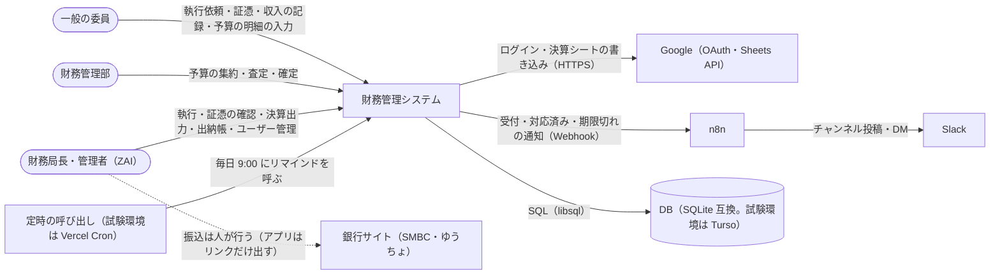
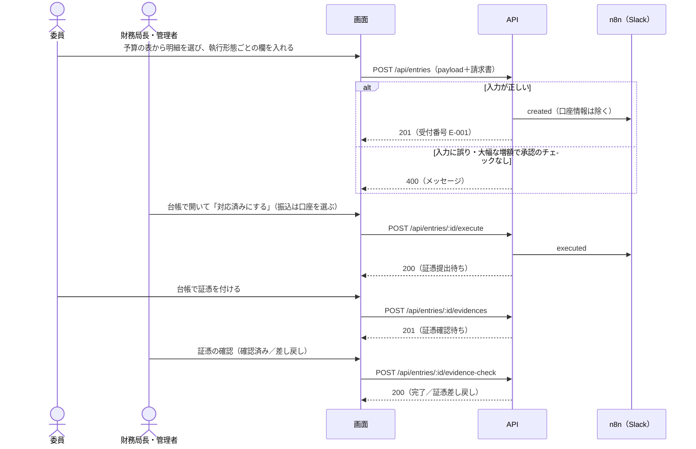
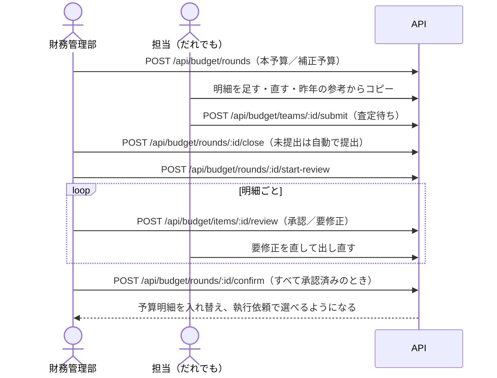
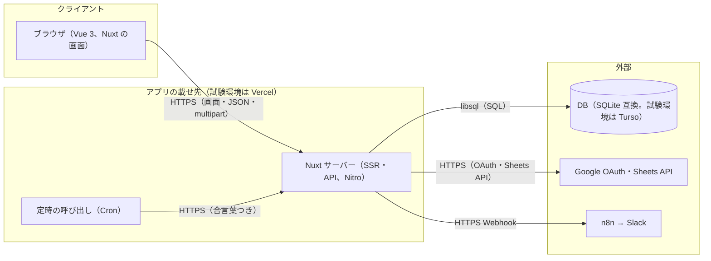
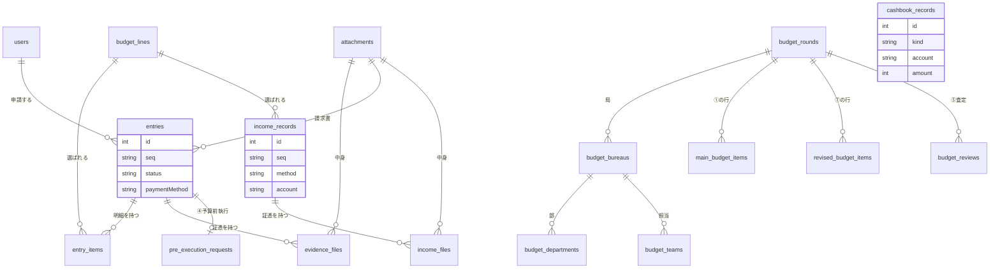
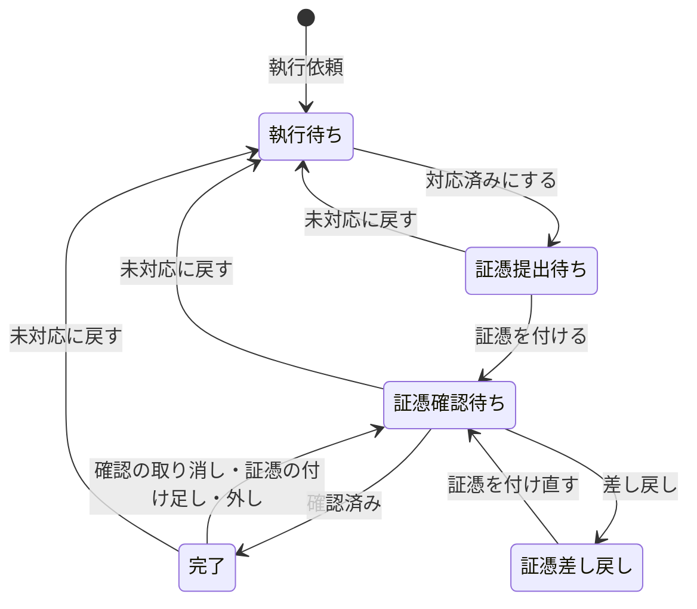
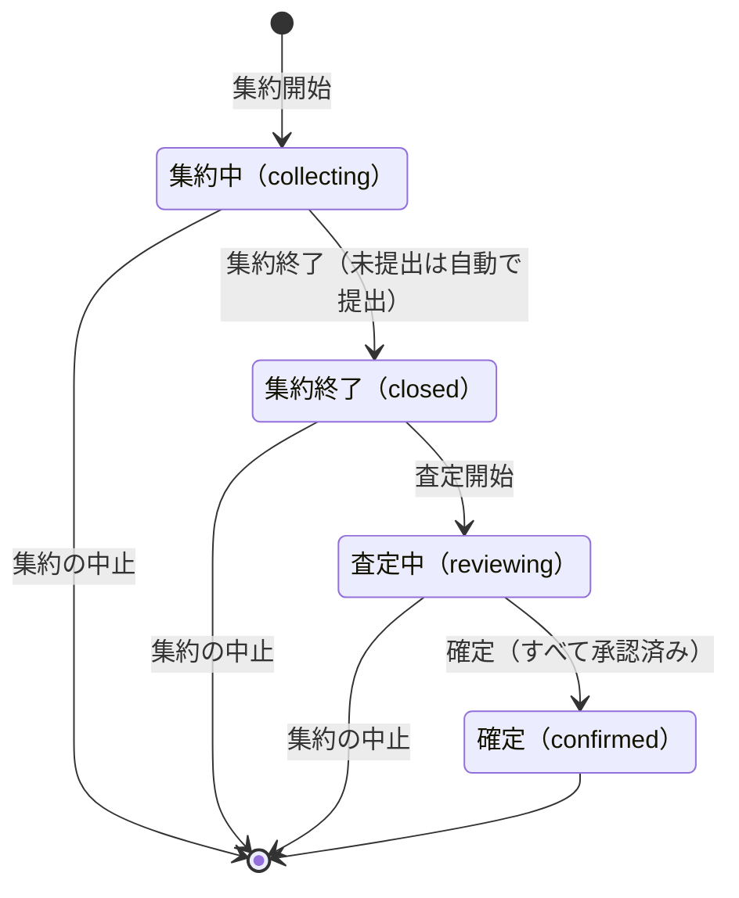
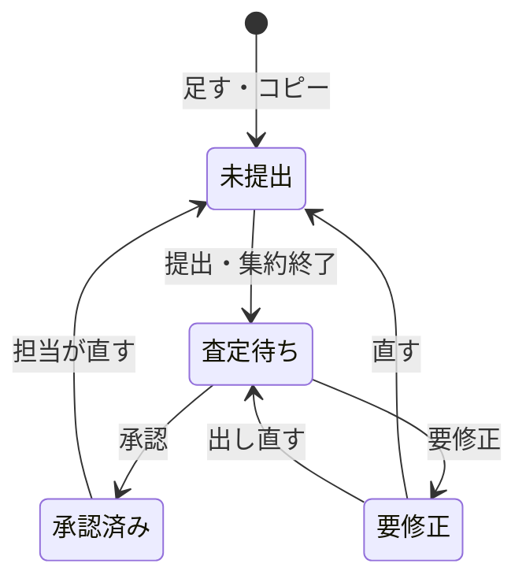
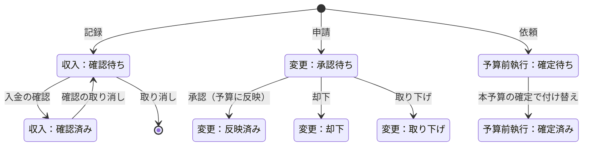

# 財務管理システム（expenditure）仕様書

実装（2026年11月2日時点、`main` ブランチ）から書き起こした仕様。コードとこの文書が食い違うときはコードが正。DB の表と列、サーバーの中の処理の流れは [内部フロー.md](内部フロー.md) にまとめる。

**載せ先について**：今は試験のために Vercel（アプリ）と Turso（DB）に載せているが、本番でこれらを使うかは決まっていない。この文書では、アプリの仕組み（Nuxt のサーバーと SQLite 互換の DB）と、今の試験環境（Vercel＋Turso）を分けて書く。

---

## 1. 概要

### 背景

五月祭常任委員会の予算執行（支払い・発注・立替精算）は、Googleフォーム＋スプレッドシート＋GAS の「予算執行依頼フォーム」「証憑提出」「台帳」で運用していた。項目番号の手入力、同じ行の複数シートへのコピー、Drive の固定フォルダへの証憑の保存、決算の手作業の集計が負担になっていた。本システムは、予算の集約から執行・証憑の管理・収入の記録・出納・決算までを一つのWebアプリで扱い、これらを置き換える。

| 旧（GAS） | 新（本システム） |
|---|---|
| 項目番号をフォームに手入力 | 予算の表（「支出」シートと同じ見た目）から明細を選ぶ。複数選択・款ごとの一括選択可 |
| 形態別シート・番号順・申請順に同じ行をコピー | 申請は1件1行で保存し、一覧の切り替えは表示（ビュー）で行う |
| 請求書・証憑を Drive の固定フォルダへ | 添付はDBに保存し、申請から直接開ける |
| 証憑は専用のフォームで提出 | 台帳で申請を開いて証憑を付ける。ファイル名は自動で付け直す |
| 「補正予算からの変更」を申請者が選ぶ | 予算額と執行額から自動判定して表示（申請者は選ばない） |
| 決算は手作業で集計 | 決算総会に出す決算シート（支出詳細・証憑（支出）・収入詳細）と同じ形で Excel / Googleスプレッドシートへ出力 |
| 口座の残高と執行の突き合わせは手作業 | 出納帳で口座ごとの帳簿の残高を出し、数えた残高との差を出す |

### Goals

- 執行依頼は予算の表から明細を選んで出せ、項目番号を手で打たずに済む（予算にない項目のときだけ手入力）。
- 1件の申請はDBの1行で、台帳の表示の切り替えで行をコピーしない。
- 大幅な増額（1万円以上）は、役員会の承認のチェックがないとサーバーが受け付けない。
- 口座情報は財務局長・管理者以外へのレスポンス・通知に1件も含めない。
- 決算シート（支出詳細・証憑（支出）・収入詳細・執行一覧）をボタン1回で出力でき、MF99_決算と同じ列・色・書式になる。
- 予算の集約（本予算・補正予算）を、集約開始 → 集約終了 → 査定開始 → 確定 の4段階でアプリの中だけで終えられる。
- 出納帳で、口座（SMBC・ゆうちょ・MUFG・現金）ごとに数えた残高と帳簿の残高の差が0円かどうかを確かめられる。

### Non-Goals

- 銀行・カード会社との自動連携（残高・明細の自動取得、振込の自動実行）。振込は銀行サイトで人が行い、アプリには結果を記録する。
- 会計ソフトとしての複式簿記（仕訳・勘定科目・貸借対照表）。出納帳は口座ごとの出入りと残高まで。
- 決算シートのうち「収支概観」「支出項目概説」など、説明文のデータを要するシートの出力。
- 多言語対応。画面は日本語だけ。

---

## 2. 用語集

| 用語 | 意味 |
|---|---|
| 予算明細 | 予算スプレッドシート「支出」シートのうち、金額が入っている行。申請で選ぶ単位 |
| 局・担当・款・項・目・節 | 予算の階層。局 → 担当 → 款 → 項 → 目 → 節 |
| 項目番号 | 予算の番号。本予算は `out-03-02-06`、補正予算は `out01-01-02` の形。連続する番号は `out01-04-01~03` のように「~」で縮めて表示する |
| 収入・支出 | 予算の中の、入ってくるお金（収入）と出ていくお金（支出）。同じ表に持ち、項目番号の頭で分ける（表の下の補足） |
| 執行依頼 | 支払い・発注などを財務局（ZAI）に依頼する申請。番号は `E-001` から。選べるのは支出の予算明細だけ |
| 収入の記録 | 入ってきたお金（協賛金・売上など）の記録。番号は `I-001` から。状態は **確認待ち** → **確認済み**（財務局長・管理者が入金を確かめた） |
| 証憑 | 領収書・見積書など。台帳で申請に付ける（以前は証憑提出フォームで `R-001` 形式の申請として出していた） |
| 執行形態 | 振込 / 発注 / 立替 / 現金執行 / カード決済 / その他 |
| 支払方法 | 対応済みにしたときに決まる、実際にお金を出した方法（振込（SMBC）・口座引落・デビット（MUFG）など。5.7.4） |
| 状態（申請） | 申請の進み具合。執行待ち → 証憑提出待ち → 証憑確認待ち → 完了（表の下の補足） |
| 対応済み | ZAI が執行を終えた状態（証憑提出待ち・完了）。執行待ちに戻せる |
| 本予算 / 補正予算 | 確定している予算の種類。画面の文言がこれに合わせて変わる |
| 予算の集約 | 各担当が明細を入れて提出し、財務管理部が査定・折衝して確定するまでの1回分。本予算と補正予算がある。期は第100期で固定 |
| 査定 | 財務管理部が、提出された明細ごとに「承認」か「要修正（理由つきで担当に戻す）」を決めること |
| 予算の変更 | 集約とは別に、確定した今の予算の項目を修正・追加・削除すること（②予算変更申請DB） |
| 予算前執行 | 本予算の確定前に、新しい年度の分を執行すること（④予算前執行DB） |
| 出納帳 | 口座（SMBC・ゆうちょ・MUFG・現金）ごとのお金の出入りと残高の一覧 |
| 帳簿の残高 | 出納帳で、期首の残高に執行・収入・移動・調整を足し引きして求めた残高。開くたびに計算し直す |
| 残高の照合 | 通帳・手元の現金で数えた残高を、帳簿の残高と比べること。差が0円なら一致 |
| 期首の残高・口座間の移動・調整 | 出納帳に手で書く記録（5.13） |

**補足：収入と支出の項目番号**

- 収入は `in01-01-01`、支出は `out01-01-01` の形。
- 局の番号は支出の形（`out01`）で持ち、収入の番号を付けるときは頭を `in` に替える。
- 画面では「収入の部」「支出の部」に分けて出す。

**補足：申請の状態**

| 状態 | 意味 |
|---|---|
| 執行待ち | ZAI がまだ対応していない。ZAI 向けの表示（発注のまとめ・リマインド・「未対応に戻す」）では「未対応」と書く |
| 証憑提出待ち | ZAI が執行した。証憑はまだ |
| 証憑確認待ち | 証憑が出た。財務局長・管理者の確認待ち |
| 完了 | 財務局長・管理者が証憑を確認した |
| 証憑差し戻し | 確認で差し戻した。証憑を付け直すと証憑確認待ちに戻る |

---

## 3. 前提・制約

| 区分 | 内容 | 根拠／正本 |
|---|---|---|
| 技術 | Nuxt 4.5（Vue 3、SSR）、nuxt-auth-utils、Drizzle ORM（libsql）、zod v4、exceljs、feather-icons | `package.json` |
| 技術 | DB は SQLite（libsql クライアントで、ファイルか libsql 互換のサーバーにつなぐ）。マイグレーションは手元では起動時、試験環境ではビルド時に適用 | `server/plugins/migrate.ts`・`package.json` の `build:vercel` |
| 技術 | 本番の載せ先（アプリ・DB）は未定。Node.js でサーバーを動かせて、SQLite（libsql）の DB を置ける所なら載せられる。今の試験環境は Vercel＋Turso | 13章 |
| 容量 | 添付ファイルは 4MB まで（試験環境の Vercel の関数が受け取れる 4.5MB に合わせた。載せ先が変われば見直せる） | `shared/constants.ts` の `MAX_ATTACHMENT_BYTES` |
| 容量 | 試験環境の Turso（無料プラン）は DB 100個・保存 5GB まで。Vercel の Turso 連携でデプロイごとに DB の分身を作るとすぐ上限に達するので、分身は作らない設定にしている | Turso・Vercel の管理画面 |
| コスト | 試験環境は Vercel（Hobby）と Turso（無料プラン）の範囲で動かす。本番の費用は載せ先とあわせて未定 | Vercel・Turso の管理画面 |
| 組織 | ログインできるのは ECC のメール（`g.ecc.u-tokyo.ac.jp`）だけ。本番は Nogiku のログインを使う予定 | `NUXT_ALLOWED_EMAIL_DOMAIN` |
| 組織 | 予算の期は第100期で固定 | `shared/constants.ts` の `BUDGET_TERM` |
| 組織 | 局は JIM・ZAI・SSK・EVE・PR・SYS の6つ（SOM・NT・ECO は今はない） | `shared/constants.ts` の `BUREAUS` |
| 法務 | リポジトリは公開のため、予算データ・口座情報・秘密情報を入れない | `.gitignore` |
| 運用 | 変更はすべて `local` ブランチで行い、`local → main` のプルリクエストでマージする（`main` に直接プッシュしない）。マージ後は `local` に `main` を取り込んでから次の作業をする | — |

---

## 4. システムコンテキスト（C4 L1）

📐 読者：全員／問い：このシステムの境界はどこか／範囲：利用者と、つながる外部システム

- 補足：銀行とはつながっていない。振込・残高の確認は人が銀行サイトや通帳で行い、結果をアプリに記録する。DB と定時の呼び出しは、本番の載せ先によって変わる。

---

## 5. 機能要件

### 5.1 ユースケース一覧

| ID | ユースケース | アクター | 状況 | 備考 |
| --- | --- | --- | --- | --- |
| UC-01 | ログインする | 全員 | 実装済み | Google・テスト用合言葉・開発用。Nogiku との連携は未実装（11.1） |
| UC-02 | 予算の表から明細を選んで執行依頼を出す | 一般 | 実装済み | 5.5 |
| UC-03 | 予算にない項目の執行依頼を出す | 一般 | 実装済み | 款〜節と項目番号を手入力（5.5.1） |
| UC-04 | 予算前執行を依頼する | 一般 | 実装済み | 5.8.4 |
| UC-05 | 台帳で申請を見る・証憑を付ける | 一般 | 実装済み | 5.6・5.7 |
| UC-06 | 申請を執行する（対応済みにする） | 財務局長・管理者 | 実装済み | 5.7.4 |
| UC-07 | 発注をサイトごとにまとめて執行する | 財務局長・管理者 | 実装済み | 5.7.5 |
| UC-08 | 証憑を確認する・差し戻す | 財務局長・管理者 | 実装済み | 5.6.1 |
| UC-09 | 予算の集約を始める・終える・確定する | 財務管理部 | 実装済み | 5.8 |
| UC-10 | 担当の予算の明細を入力・提出する | 全員 | 実装済み | 5.8 |
| UC-11 | 明細を査定する（承認・要修正） | 財務管理部 | 実装済み | 5.8 |
| UC-12 | 昨年の本予算・決算を取り込んで参考にする | 財務管理部・全員 | 実装済み | 5.8 |
| UC-13 | 確定した予算を変更する（申請・承認） | 担当の人・財務管理部 | 実装済み | 5.8.3 |
| UC-14 | 収入を記録する・入金を確認する | 全員・財務局長・管理者 | 実装済み | 5.12 |
| UC-15 | 決算シートを出力する | 財務局長・管理者 | 実装済み | 5.9。スプレッドシート出力は Google Cloud の設定待ち |
| UC-16 | 出納帳で口座の残高を照合する | 財務局長・管理者 | 実装済み | 5.13 |
| UC-17 | ユーザーを登録する・権限を変える | 財務局長・管理者 | 実装済み | 5.10 |
| UC-18 | Slack で受付・対応済み・期限切れを知る | 全員 | 実装済み | 5.11 |

### 5.2 主要フロー：執行依頼から証憑の確認まで

📐 読者：開発者／問い：執行依頼のとき誰が何を呼ぶか／範囲：正常系＋主な異常系

- 補足：通知の失敗は申請の失敗にしない（ログに残す）。

### 5.3 主要フロー：予算の集約

📐 読者：開発者・財務管理部／問い：集約の段階ごとに誰が何をするか／範囲：正常系

- 補足：どの段階でも `DELETE /api/budget/rounds/:id`（集約の中止）で元に戻せる。

### 5.4 画面一覧

| パス | 画面 | 表示する人 |
|---|---|---|
| `/login` | ログイン | 未ログイン |
| `/` | ホーム（各画面へのカード） | 全員 |
| `/requests/new` | 執行依頼 | 全員 |
| `/requests/pre` | 予算前執行（執行依頼と同じフォームで、予算の表から選ばず支出項目名を書く） | 全員 |
| `/entries` | 台帳（上の「支出｜収入」で切り替える。支出は執行依頼の一覧で、証憑の提出・執行・決算出力もここ。収入は収入の一覧で、証憑・入金の確認もここ） | 全員（執行・入金の確認は財務局長・管理者） |
| `/incomes/new` | 収入の記録（5.12） | 全員 |
| `/incomes` | 前の収入台帳。開くと台帳の「収入」（`/entries?flow=income`）へ移る | 全員 |
| `/cashbook` | 出納帳（口座ごとの残高・残高の照合・出入りの一覧。5.13） | 財務局長・管理者 |
| `/budget` | 予算（確定した予算。下の補足） | 全員 |
| `/budget/collect` | 集約（下の補足） | 全員 |
| `/budget/team/:id` | 担当の予算の明細の入力・提出（下の補足） | 全員（入力・提出もだれでもできる） |
| `/budget/review` | 査定（下の補足） | 財務管理部・財務局長・管理者 |
| `/budget/setup` | 局・部・担当と入力する人 | 財務管理部・財務局長・管理者 |
| `/budget/changes` | 予算の変更（集約とは別に、今の予算の項目を修正・追加・削除。申請・承認・履歴） | 全員（申請はその担当の人、承認と直接の変更は財務管理部） |
| `/users` | ユーザー管理 | 財務局長・管理者 |
| `/settings` | 通知設定（Slack の DM） | 全員（ヘッダーの名前から開く） |

**予算の画面の補足**

- `/budget`（予算）
  - 上に「収入と支出」の対比を出す（収入・支出・収支（収入−支出）の合計と、局ごとの表）。
  - その下に「収入の部」「支出の部」の表を出す。
  - 予算がまだないときは、最初の予算の取り込みを出す。
- `/budget/collect`（集約）
  - 集約の進み具合と、自分が入力する担当を出す。
  - 財務管理部は、ここで集約の開始・確定・中止をする。
  - 進み具合に出す担当は、取り込んだ昨年の本予算・決算に明細がある担当と、この集約に項目がある担当だけ（参考を取り込んでいなければすべて）。
- `/budget/team/:id`（担当の画面）
  - 上に今年の明細（提出する分）を色の付いた実線の枠で、その下に昨年の本予算・決算（参考）を点線の枠で出す。
  - 本予算の「昨年から」は、取り込んだ昨年の本予算の同じ項目番号の金額と比べる（コピーしただけなら「変更なし」）。
  - 参考のうち、コピー済みの行は薄くする。
  - 今年の明細は、修正を開かなくても仕様・詳細・執行予定時期・リンク・備考と、新規・予算前執行の印を出す。
- `/budget/review`（査定）
  - 局のタブ・担当の選択に出す担当は、集約と同じ。
  - カードには、仕様・詳細・執行予定時期・リンク・備考を書いてあればすべて出す。

**共通レイアウト**

- 上部ヘッダー：「財務管理システム」、役割バッジ、氏名・アバター（押すと通知設定）、ログアウトのアイコン。**スクロールしても上部に固定**。
- 左サイドバー：メニューを枠に分けて並べる。ホームのカードも同じ枠で並べる。
  - ホーム
  - 執行：執行依頼・予算前執行
  - 収入：収入の記録
  - 台帳：台帳（支出・収入）・出納帳（権限があれば）
  - 予算：予算・集約・査定（権限があれば）・予算の変更
  - 管理：ユーザー（権限があれば）
  - 幅800px以下では、ヘッダーの下に横スクロールのメニューとして出す。
- 配色：メイン `#F5EDE9`、サブ `#F9F3DC`、ボタン・選択中 `#EAD9D1`。端末がダークモードでも同じ配色で表示する。
- ブラウザのタブのアイコンは Feather の dollar-sign（`public/favicon.svg`）。
- スマホ（幅600px以下）では台帳の各行をカード表示にする。
- 環境名 `NUXT_PUBLIC_ENV_LABEL` を設定すると、最上部に「（環境名）：本物の口座情報や個人情報は入力しないでください」の帯を出す。
- ボタン・見出し・札はなるべく名詞で終える（承認・確定・変更なし など）。説明の文は句点（。）で終える。

### 5.5 執行依頼（`/requests/new`）

Googleフォーム「予算執行依頼フォーム」と同じ質問・説明文を基本とする。

#### 5.5.1 共通項目

| 項目 | 必須 | 仕様 |
|---|:-:|---|
| 申請者氏名 | ○ | ログイン中の氏名が初期値 |
| 局 | ○ | 選択肢は取り込んだ予算の局から作る。略称が分かる局は「ZAI（財務局）」の形で、申請には略称を記録 |
| 担当名 | ○ | 明細を選ぶと、予算の「担当」列（例：環境計画部長）が初期値で入る |
| 項目番号 | ○ | 予算の表から選ぶ（5.5.2）。予算にない項目は手入力（表の下） |
| 支出項目名 | ○ | 選んだ明細から自動で入る（表の下） |
| 執行形態 | ○ | 振込 / 発注 / 立替 / 現金執行・カード決済（デビットカード）・その他 |

**支出項目名の自動入力**

- 款（または項・目・節）をまるごと選んだら、その名前。
- 款を複数まるごと選んだら、「・」でつなぐ。
- それ以外は最初の明細名（複数なら「ほかN件」）。
- 手で直したら、それ以降は上書きしない。

**予算にない項目の手入力**（「予算にない項目を手入力する」）

- 款（必須）・項・目・節と、項目番号を入れる。
  - 項目番号は `out01-03-02` の形（以前の `out-03-02-06` の形も可）。
- 局・担当・款を入れると、項目番号の候補が自動で入る。
  - 同じ担当・同じ款が、予算か、これまでの予算にない執行依頼にあれば、その款の続きの番号。
  - なければ、その局の新しい款の番号。
  - 担当名は英語の略称でも日本語名でもよい。
  - 手で直したら、それ以降は上書きしない。
- 支出項目名は、項（なければ款）・目・節から自動で入る。
- 款・項・目・節は、申請の詳細（`details.budgetPath`）に残す。

#### 5.5.2 予算明細の選択（予算の表）

- 予算スプレッドシート「支出」シートと同じ列・並び・色で表示する。
  - 明細の行には、その明細の項目番号を出す。局・款の見出しの行には局・款の番号を出し、項・目・節の見出しの行には番号を出さない。
  - 項の下に目・節がある明細では、項の見出しの行をいつも出し、項の行には目・節を入れない。目・節の見出しの行は、その下に明細が2件以上あるときだけ出す。1件だけなら、明細の行に目・節の名前を並べて1行にする。項は名前で見分ける。
  - 局 `#fff2cc`、担当 `#d9ead3`、款 `#c9daf8`、列見出し `#d9d9d9`。その階層の列から右だけを塗る。項・目・節の行は塗らない。選んだ明細は選択の色が優先。
- 枠の高さは固定で、中で縦横にスクロールする。列見出しは枠の上端に固定。
- 上部に局のタブ（既定は「すべて」）。件数と、その局で選択中の件数（✓N）を表示。フォームで局を選ぶと、そのタブに切り替わる。
- 絞り込み欄：項目番号・名前・款・担当・取引先・数量に部分一致（空白区切りでAND）。
- 明細の行をクリックで1件ずつ選択。款・項・目・節の見出しのチェックボックスで配下をまとめて選択・解除。見出しにマウスを乗せると、対象の明細を色付きで示す。
- 選択した行の色は `#EAD9D1`（ローズベージュ）。
- 表の上に「選択中N件・予算額合計」と、款ごとにまとめた選択一覧（款ごと／一部、外す・まとめて外す）を表示する。選んだ項目番号は連続していれば「~」で縮める。
- **ここでは選ぶだけ**。金額・数量・取引先は執行形態ごとの欄で入力する（5.5.3）。

#### 5.5.3 明細ごとの入力（執行形態の欄の中）

明細を選ぶと、各執行形態の欄に「明細ごとの入力表」が出る。最初は予算の値が入っている。

| 執行形態 | 出す列 | 取引先の扱い |
|---|---|---|
| 振込 | 数量・取引先・振込金額 | 明細ごとに入力 |
| 発注 | 数量・金額（税込。必須） | 選んだ通販サイトを全明細の取引先にする |
| 立替 | 数量・金額 | 「購入先」を全明細の取引先にする |
| 現金執行・カード決済・その他 | 数量・取引先・金額 | 明細ごとに入力 |

- 金額はカンマ・全角数字・「¥」「円」を受け付ける（例「１２,０００円」→12000）。数字でなければその場でエラー表示。
- 予算額と違う金額は「予算比 ±¥N」を表示。表の下に合計（金額未入力の件数も）。
- 明細を選んでいるときは、申請全体の金額（振込金額・立替合計金額・金額）と数量は**明細の値から自動で決まり**、別の入力欄は出さない。予算にない項目を手入力するときだけ、従来どおりの金額・数量欄を出す。
- 申請の数量は、明細が1件ならその数量、複数なら「明細名 数量」を「、」でつないだもの。
- 発注・立替から他の形態に切り替えると、明細の取引先を予算の値に戻す。

#### 5.5.4 執行形態ごとの項目

**振込**

| 項目 | 必須 | 備考 |
|---|:-:|---|
| 請求書 | | PDF・画像、4MBまで |
| 振込期限 | ○ | 日付 |
| 振込金額 | ○ | 明細の合計（手入力時のみ入力欄） |
| 金融機関名・支店名 | ○ | |
| 口座種別 | ○ | 普通 / 当座 / その他（自由記述） |
| 口座番号 | ○ | 数字1〜8桁 |
| 口座名義 | ○ | |
| 備考 | | |

口座情報は財務局長・管理者だけが閲覧でき、Slack通知には含まれない。

**発注**

| 項目 | 必須 | 備考 |
|---|:-:|---|
| 通販サイト | ○ | ASKUL / モノタロウ / Amazon / 楽天 / アースダンボール / その他（自由記述） |
| 商品ページのリンク | ○ | 複数可（改行区切り） |
| 金額（税込） | ○ | 送料を除いた商品の税込金額。明細を選んだときは明細ごとの金額（必須）の合計（手入力時のみ入力欄）。同じサイトの発注とまとめて送料無料になるかの判断に使う |
| 数量 | 条件付き | 5.5.6 参照 |
| いつまでに必要ですか？ | ○ | 日付 |
| 配達場所 | ○ | 駒場（A103）/ 本郷（6号）/ その他 |
| 備考 | | |

送料の案内は申請フォームには出さない（執行時に台帳で出す。5.7.5）。

**立替**

| 項目 | 必須 | 備考 |
|---|:-:|---|
| 購入先 | ○ | |
| 立替合計金額 | ○ | 明細の合計（手入力時のみ入力欄） |
| 紙媒体の領収証の有無 | ○ | 有り / 無し |
| 立替予定日 | ○ | |
| 備考 | | |

立替も執行依頼の時点で台帳に載る。領収書などの証憑は、購入後に台帳でこの申請を開いて提出する（5.6）。

**現金執行・カード決済（デビットカード）・その他**

| 項目 | 必須 | 備考 |
|---|:-:|---|
| 執行形態（2段目） | ○ | 現金執行 / カード決済（デビットカード）/ その他（自由記述） |
| 金額 | ○ | 明細の合計（手入力時のみ入力欄） |
| 執行希望日時 | ○ | 日時 |
| 詳細 | ○ | |
| 備考 | | |

#### 5.5.5 表から推測して入れる初期値

空欄か、前に自動で入れた値のままの欄だけ入れ替える。**自分で書き換えた値は上書きしない。**

| 欄 | 推測のもと |
|---|---|
| 局 | 最初に選んだ明細の局（未入力のときだけ） |
| 担当名 | 最初に選んだ明細の「担当」 |
| 購入先（立替） | 選んだ明細の予算の取引先（重複なし、「、」区切り） |
| 通販サイト（発注） | 選んだ明細の取引先が1種類なら、その名前を選択肢に寄せる（アスクル→ASKUL、アマゾン→Amazon、monotaro→モノタロウ など）。選択肢になければ「その他」に入れる |

#### 5.5.6 数量の必須条件

| 場合 | 数量 |
|---|---|
| 予算にない項目を手入力（発注） | 必須 |
| 予算から選んだ明細（発注） | 予算の表に数量がある明細だけ必須。数量がない明細は任意（入力欄に「（任意）」） |
| 振込・立替・その他 | 任意 |

#### 5.5.7 予算からの変更と役員会の承認

- 申請の最後（最終確認の直前）に「（本予算／補正予算）からの変更」を**表示だけ**する。申請者は選ばない。
- 判定：選んだ明細の予算額合計と、明細ごとの金額（未入力は予算額）の合計の差 d。

| 条件 | 表示 |
|---|---|
| d ≥ 10,000円 | 大幅な増額（1万円以上） |
| 0 < d < 10,000円 | 増額（1万円未満） |
| d < 0 | 減額 |
| d = 0 | 変動なし |

- 「予算額 ¥A → 執行額 ¥B、差額 ±¥C」も併記する。
- **大幅な増額のときは「役員会の承認を得ました」のチェックが必須**。チェックがないと送信できず、サーバーも拒否する。
- 判定結果はサーバーが金額から計算して保存する（申請者が送った値は使わない）。予算にない項目の申請では判定しない。

**予算の変更も申請する（任意）**

- 金額を入れた明細のうち、予算額と違うものが1件でもあれば、「予算の変更（任意）」の欄を出す。
  - 違う明細の一覧（項目番号・明細名・予算額 → 執行額）を出す。
  - 「予算の変更も申請する」のチェック欄を置く。初めはチェックなしで、チェックしなくても送信できる。
  - チェックしたら、変更の理由を書ける（任意）。
  - ふつうは申請しなくてよい（予算との差は補正予算・決算で見る）。同じ項目をこのあとも執行するときなどに使う。
- チェックしたとき、執行依頼と一緒に、違う明細ごとに予算の変更（②、修正）を申請する（5.8.3）。
  - 金額を執行額にする。単価があって数量×単価が執行額と合わなくなるなら、単価は空にする。ほかの値はそのまま。
  - 理由は、書いた理由と「執行依頼 E-001 で、執行額が予算額と違うため（予算額 ¥A → 執行額 ¥B）」。
  - 申請は承認待ちになる。財務管理部が出した執行依頼でも、すぐには反映しない（予算の変更の画面で承認する）。
  - 担当の割り当てがなくても申請できる（承認するのは財務管理部なので）。
  - その項目にもう承認待ちの変更があるときなどは、その明細だけ申請せず、受付の画面に理由を出す。執行依頼は受け付ける。
- 受付の画面に、申請した項目番号（または申請できなかった項目番号と理由）と、「予算の変更」へのリンクを出す。

#### 5.5.8 送信

- 「以上の内容に誤りがないことを確認しましたか？」に「はい」でチェックすると送信できる。送信後の編集はできない。
- 受付後に受付番号（`E-001` 形式）を表示する。

### 5.6 証憑の提出（台帳から）

証憑提出の専用フォームはなく、**台帳で申請を開いて証憑を付ける**。以前の証憑提出フォームで出された申請（`R-001` 形式）は、台帳にそのまま残る。

- 付けられる人：ログインしている人なら誰でも、どの申請にも付けられる（発注は ZAI が証憑を受け取るので、財務局長・管理者が付ける）。
- 1つの申請に何件でも付けられる（立替で領収書が複数ある場合など）。
- 外せる人：付けた本人と、財務局長・管理者。

| 項目 | 必須 | 備考 |
|---|:-:|---|
| 種類 | ○ | 領収書 / 見積書 / その他（以前に付けたものには「レシート」もあり、決算シートでは領収書として扱う） |
| 金額 | | 分かれば入れる |
| 立替日（立替）／執行日（それ以外） | | 立替以外は ZAI が執行済みのはずなので、執行日が初期値で入る |
| 返金時期 | | 立替のときだけ。委員返金と同時 / できる限り早く。申請に記録する |
| ファイル | ○ | PDF / JPEG / PNG、4MBまで（HEIC・WebP の写真は、画面で JPEG にしてから送る） |

**ファイル名は自動で付け直す**

- 形：「項目番号_担当名_支出項目名_月日（4桁）」
  - 例：`out01-04-01~03_資材計画部長_レンタカー代_1017.pdf`
- 項目番号は、連続していれば「~」で縮める。
- 月日は、入力した日付（立替日・執行日）。
  - 空なら、立替以外は執行日。
  - それもなければ、提出した日（日本時間）。
- 同じ申請の2件目からは、末尾に `_2`, `_3` を付ける。

#### 5.6.1 証憑の確認

ZAI が対応済みにしたあと、証憑が付くと **証憑確認待ち** になる。財務局長・管理者が台帳で申請を開き、「証憑の確認」欄で確認する。

- **確認済み**：完了になる。「確認の取り消し」で確認待ちに戻せる。
- **差し戻し**：理由（必須）を書いて差し戻す。理由はだれにでも「証憑の確認」欄に出る。証憑を付け直すと、理由は消えて確認待ちに戻る。
- 確認済みのあとで証憑を付け足す・外すと、確認待ちに戻る。対応済みを執行待ちに戻したときも、確認はやり直しになる。
- 確認待ちの申請は、台帳の「証憑確認待ち」でまとめて見られる。
- この段階を入れる前に完了していた申請（対応済みで証憑もある）は、確認済みとして扱う。
- 記録する列：`entries.evidence_checked_at`・`evidence_checked_by`（確認した時刻と人）、`evidence_return_comment`（差し戻しの理由）。

### 5.7 台帳（`/entries`）

支出と収入を1つの画面で扱う。上の「支出｜収入」で切り替える（収入のときは URL に `?flow=income`）。この節は支出（執行依頼）の一覧。収入の一覧は 5.12 の「台帳の収入」。

全員がすべての申請を閲覧できる。口座情報は財務局長・管理者にだけ返す。

#### 5.7.1 表示の切り替え（上のボタン、左から）

| ボタン | 対象 | 並び |
|---|---|---|
| 番号順 | 全申請 | 項目番号 → 申請日時 |
| 期限順（既定） | 全申請 | 期限が早い順（期限なしは最後）→ 申請日時 |
| 執行待ち | ZAI がまだ対応していない申請 | 期限順 |
| 証憑未提出 | 証憑がまだ付いていない執行依頼 | 期限順 |
| 証憑確認待ち | 対応済みで証憑が付き、まだ確認も差し戻しもしていない申請 | 期限順 |
| 振込・発注・立替・現金執行・カード決済・その他 | その形態の申請 | 期限順 |

「期限」は振込期限・必要日・立替予定日・執行希望日時・（証憑）立替日。

#### 5.7.2 一覧の列

番号 / 申請日 / 項目番号（連続は「~」で縮める）/ 支出項目 / 数量 / 金額 / 形態 / 期限・予定日 / 申請者（局/担当）/ 状態 / 証憑

- **状態**
  - 色：執行待ち（赤）→ 証憑提出待ち（黄土色）→ 証憑確認待ち（青）→ 完了（緑）。証憑差し戻しは赤。
  - 証憑提出待ち以降は、ZAI が対応した日時も小さく出す。
  - 証憑が先に出ていても、ZAI が対応するまでは執行待ち（立替の返金待ちなど）。
- **証憑**：件数。なければ赤字で「未提出」。
- **形態**：発注は通販サイトまで出す（例「発注（ASKUL）」）。対応済みで支払方法があれば「発注（ASKUL） / 口座引落」。
- スマホではカード表示（1行目に番号・申請日・状態、2行目に支出項目と金額、以下に項目番号・数量・形態・期限・申請者）。

#### 5.7.3 詳細（行をクリック）

- 予算明細の表（項目番号・明細・数量・取引先・予算額・執行額・予算比）と合計。
- 形態ごとの追加項目（通販サイト、商品リンク、購入先、返金時期、予算からの変更、役員会の承認「承認済み」、口座情報、予算前執行が必要な理由など）。
- 添付ファイル（請求書）を開くリンク。
- 証憑の欄（5.6）：付けた証憑の一覧（ファイル名・種類・金額・日付、外すボタン）と、証憑を付けるフォーム。

#### 5.7.4 執行（財務局長・管理者）

- 明細ごとの執行額・数量・取引先を直して保存できる。予算と同じ値は「入力なし」として保存する。
- 「対応済みにする」：直した明細の値も一緒に保存する。
  - 振込は使った口座（SMBC / ゆうちょ）を選ぶ（必須）。口座の横に銀行サイトへのリンク（`NUXT_PUBLIC_BANK_LINK_SMBC` / `_YUCHO`）。
  - 明細のない申請は確定金額・数量を入力できる。
- 「未対応に戻す」で執行待ちに戻せる。
- 対応済みにしたときの支払方法の記録（出納帳ではこの支払方法から口座を決める。5.13）：

| 形態 | 記録する支払方法 | 出納帳の口座 |
|---|---|---|
| 振込 | 振込（SMBC）/ 振込（ゆうちょ） | SMBC / ゆうちょ |
| 発注 | 口座引落 | SMBC |
| カード決済 | デビット（MUFG） | MUFG |
| 現金執行 | 現金執行 | 現金 |
| 立替・以前の証憑提出フォームの申請（R-） | 立替 | 現金 |
| その他 | その他（内容） | 決まらない |

#### 5.7.5 発注のための機能

- **サイトで絞り込み**：「発注」を選ぶと「通販サイト：すべて／ASKUL 3／Amazon …」のボタンを出す。数字はそのサイトの**執行待ち**の件数（0件なら出さない）。絞り込みはURL（`?view=発注&site=ASKUL`）に持つ。
- **未対応の発注（サイト別）**：表の上に、サイトごとの執行待ちの件数・合計と、送料無料の基準に届くか（届かなければあと何円か）を出す。サイト名から絞り込みへ移動できる。
- **送料の案内**：執行待ちの発注を開くと、その発注の金額と、同じサイトの他の執行待ちの発注をもとに送料の案内を出す（例「まとめると¥X になり、送料無料になります。まとめて発注してください」）。
- **まとめて発注**（財務局長・管理者、サイトで絞り込んだとき）：
  - そのサイトの執行待ちの発注をチェックボックス付きで一覧（最初は全選択）。各行に数量・必要日・金額・商品リンク。
  - 選んだ分の合計、送料無料の基準との比較、いちばん早い必要日を表示。
  - 「商品リンクと数量の一覧をコピー」：番号・品名・数量・必要日・配達場所と商品リンクをクリップボードへ。
  - 「選んだN件をまとめて対応済みにする」：確認ダイアログのあと、選んだ発注を順に対応済みにする（金額・数量は申請のまま）。
- 送料の案内は**執行時（台帳）だけ**に出し、申請フォームには出さない。

送料無料の基準（`shared/shipping.ts`、2026年10月時点で調べた値）：

| サイト | 送料無料になる金額（税込） | 備考 |
|---|---|---|
| ASKUL | 2,000円以上 | 未満は440円（法人会員） |
| モノタロウ | 3,850円以上 | 3,500円（税別） |
| Amazon | 3,500円以上 | Amazon発送の商品。未満は410円〜 |
| 楽天 | 3,980円以上（目安） | ショップごとに異なる |
| アースダンボール | 基準なし | 期間限定キャンペーンのみ。まとめると送料1回分 |

### 5.8 予算の集約と査定（`/budget`）

予算は ①予算項目DB に持つ。行は書き換えず、直すたびに1行足し、項目番号ごとにいちばん新しい行を今の値とする（DB の形は 8.2）。
本予算は明細を空から作り、財務管理部が取り込んだ昨年の本予算・決算を参考にする（使える明細はコピーできる）。補正予算は ①の今の値を ⑦補正予算項目DB に写して直す。査定・折衝のやり取りは ⑤査定DB に残す。CSV の取り込みは、予算が1つもないときに最初の予算を入れるためだけに残す（5.8.1）。

集約は **集約開始 → 集約終了 → 査定開始 → 確定** の順に進める（状態遷移は 10章）。「集約」の画面の上に、今どの段階かを出す。

| 段階 | 担当（入力・提出はだれでもできる） | 財務管理部 |
|---|---|---|
| 集約中 | 明細の修正・追加・削除、提出（自分の担当の「すべて提出」でも可）。査定待ちの明細は直せない | すべて提出（全担当の未提出・要修正）、集約終了 |
| 集約終了 | 入力できない | 査定開始 |
| 査定中 | 要修正の明細（直して未提出に戻ったものも）だけ直して出し直せる。明細は足せない | 査定（承認・要修正）、すべて承認、確定 |

1. **集約開始**（財務管理部）
   - 「集約」の画面で種類（本予算／補正予算）を選んで始める（期は第100期で固定）。
   - 最新の確定した予算の局・担当が写る。
   - 本予算は明細を写さない（空から作る）。補正予算は①の今の値（承認済みの最新の行）を⑦に写す。
   - 確定していない集約は、一度に1つだけ。
2. **局・部・担当と、入力する人の設定**（財務管理部。確定まではいつでもできる）
   - **入力する人の割り当て**
     - 「局・部・担当と入力する人」で、各担当に入力する人を割り当てる（1人1担当。先に「ユーザー」に登録が要る）。
     - 割り当てた担当は、その人の「集約」の画面に「あなたの担当」として出る。
     - 入力・提出は、割り当てなくてもだれでもできる。予算の変更の申請だけは、割り当てられた人と財務管理部に限る。
   - **局・部・担当の形**
     - 局の中に部（例：屋外運用部 mng）、部の中に担当を持つ。部に入らない、局の直属の担当もある。
     - 画面も、局ごとの枠に、局の直属の担当と部ごとの枠を並べる。
   - **部**
     - 英語名と日本語名を持つ。
     - 足す・直す・消すことができる（消すと、中の担当は局の直属に戻る）。
     - 担当は「部」を選んで、部に入れる・出す。
     - 部は次の集約に写る。
   - **担当**
     - 担当名は英語の略称（例：Eco・Szi・tra・ZAI・PR・SYS・sign＝屋外設置物担当）。
     - 日本語名が「統括」「部長」で終わる担当は、1文字目を必ず大文字にする（小文字で入れても大文字にして保存する。ほかの担当は書いたまま）。
     - 日本語名（例：環境計画部長）も持つ。日本語の担当名で書かれた予算のシート・昨年の本予算・決算の CSV と合わせるのに使う。
     - 担当の名前の修正と担当の追加は、局の枠の中で行う。
   - **局**
     - 局の名前・局の番号は、局の枠で直す（局の中の担当すべてと、その集約の明細・割り当てた人に反映）。
     - 局そのものも足せる（局の名前・局の番号は、ほかの局と重ねられない）。
     - 局の番号を変えると、これから足す明細の項目番号がその番号から始まる（今ある明細の番号は変えない）。
3. **入力と提出**（だれでも、集約中）
   - 担当の画面で、明細を直す・足す・消す。
   - 本予算では、「昨年の本予算・決算（参考）」から明細をコピーできる（1件・款ごと・すべて）。
   - 終わったら「提出」で、未提出・要修正の明細をまとめて査定待ちにする。
4. **集約終了**（財務管理部）
   - 担当の入力を締め切る。
   - まだ提出していない明細（未提出・要修正）は、ここで自動で提出される（査定待ち）。
5. **査定開始**（財務管理部）
   - 「査定」の画面で、査定待ちの明細ごとに「承認」か、理由を書いて「要修正」にする。
   - 要修正の理由は担当の画面に出る。担当が直して出し直すと、また査定待ちになる。
   - まとめて承認するには、担当ごとの「まとめて承認」か、「集約」の画面の「すべて承認」（承認していない明細をまとめて承認済みに）を使う。
   - 「査定」の画面の上部にあるもの：
     - 局ごとのタブ
     - 検索（項目番号・名前・担当・取引先・備考）
     - 状態ごとの件数（査定待ち／要修正／承認済み（変更あり））。押すと切り替わる。
     - 絞り込み：担当、変更の種類（増額・減額・新規の明細・削除）、その他（新規の印・予算前執行・コメントあり・収入の明細・支出の明細）
6. **確定**（財務管理部、査定中）
   - すべての明細が承認済みになったら確定できる。
   - 番号を付けて予算明細を入れ替え、執行依頼ではこの予算から選べるようになる。
   - どの段階でも「集約の中止」で、集約中の明細を捨てて元に戻せる。
- 財務管理部は、確定まではどの段階でも明細を直せる。
- 集約・査定の一覧のカードには、最後に直した日時とひとこと（備考・要修正の理由など）を出し、直した人の名前は出さない。

| 明細の状態 | 意味 | 次に動く人 |
|---|---|---|
| 未提出 | 足した・コピーしたばかり、または担当が直した | 担当（提出する） |
| 査定待ち | 提出された | 財務管理部（承認・要修正） |
| 要修正 | 財務管理部が理由を付けて戻した | 担当（直して提出し直す） |
| 承認済み | 査定が済んだ | — |

- **本予算と補正予算の違い**
  - 本予算：明細が空から始まる。担当が足した・コピーした明細（未提出）を提出する。
  - 補正予算：写した明細が「承認済み」のまま始まる。直した・足した・消した明細だけが査定に回る。
- **収入の明細**：担当の画面の「収入の明細の追加」から足す（項目番号は `in` から）。担当の画面は「収入の部」「支出の部」に分け、集約・査定・予算の画面では金額を支出・収入・収支に分けて出す。
- **昨年の本予算・決算（本予算の集約のときだけ、担当の画面に出す参考）**：
  - **取り込み**：財務管理部が「集約」の画面の「昨年の本予算・決算の取り込み」で CSV を取り込む。
    - 種類は4つ：支出の本予算・支出の決算・収入の本予算・収入の決算。
    - 本予算は「支出」「収入」シート（5.8.1 と同じ形）。
    - 決算は「支出詳細」「収入詳細」シート（MF99_決算の形。このシステムが出す決算シートと同じ）。
    - 支出は項目番号が out から、収入は in から始まる明細だけを読む（違うシートを選んだら、明細が見つからないと出す）。
    - 決算は決算シートの見出し名で読む（項目番号・局・担当・款〜節・数量・単価・金額（「決算額」「執行額」でも可）・仕様等・取引先・備考）。項目合計・局合計は小計なので読まない。
    - 種類ごとに、取り込み直すと入れ替わる。消すこともできる（コピー済みの明細は残る）。
  - **担当の画面での出し方**：参考も「収入の部」「支出の部」に分け、本予算の「昨年から」は収入・支出とも昨年の本予算と比べる。
  - 担当の画面には、局・担当の名前が同じ明細を出す。決算は項目番号で本予算の明細に合わせ、本予算にない番号の決算は「予算外の決算」としてまとめて出す。
  - **コピー**
    - 1件・款ごと・収入（支出）の部ごと・すべてをコピーできる。同じ明細は二度コピーしない。
      - 収入の部・支出の部の見出しの右に「収入をすべてコピー」「支出をすべてコピー」、参考の上に「すべてコピー」（収入・支出の両方）を出す。
    - コピーした明細は未提出から始まる。
    - 本予算の明細は、昨年の予算額との差（変更なし／+¥N／−¥N）が出る（予算外の決算からコピーしたものは新規）。
    - コピーした明細を消すと、そのまま消える（もう一度コピーできる）。
- **明細の項目**
  - 款・項・目・節（項・目・節のどれか1つ以上）
  - 数量・単価・金額（負の数も可。数量が数で単価があれば「数量×単価」を初めに入れる）
  - 取引先・仕様・詳細・執行予定時期・リンク・備考
  - 新規・予算前執行の印
- **直す・消す**
  - 直すと、①（補正予算は⑦）に行を足し、⑤に「修正」を残して未提出に戻る。
  - 査定中に財務管理部が直すのは「折衝の反映」で、査定の状態は変えない。
  - 消すときは「削除」の行を足す。
    - 補正予算で写してきた明細は「削除」の印が付いて残る（取り消せる）。査定で承認されると、確定したときに予算から消える。
    - それ以外の明細は一覧から消える。
- **査定のやり取り**：提出・承認・要修正・修正・返事を⑤に1行ずつ残す。査定のカードと担当の画面の「やり取り」で時刻の順に見られ、要修正への返事も書ける（だれが行ったかは出さない）。
- **もとの予算との比較**：明細ごとに「変更なし／+¥N／−¥N／新規／削除」を出し、担当・全体の合計ももとの予算と並べる。
- **項目番号**
  - 形は「局の番号-款-項目」（例：`out01-04-12`）。
  - 明細を足したときに自動で付け、以後はこの番号で同じ項目を追う（款を変えても番号は変えない）。
  - 同じ担当に同じ款があればその款の続き、なければその局の次の款の 01。
  - その期で一度使った番号は使わない。
  - 昨年の本予算・決算からコピーした明細は、取り込んだ番号をそのまま使う（その期の別の担当が使っていれば新しい番号）。
- **確定の中身（予算提出・承認）**
  - 本予算：この集約の各項目の最新の行を承認済みにする。この集約にない項目（前の予算に残っているもの）は削除の行で消す。
  - 補正予算：⑦の最新の行を承認済みにし、①の今の値と違う項目だけ①に写す（承認済みの行として足す）。
  - そのあと、①の承認済みの最新の行から「支出」シートの行（補正予算の列の形）を作り、5.8.1 と同じ読み方で予算明細（`budget_lines`）と `budget_sheet_rows` を入れ替える。本予算なら、予算前執行の執行依頼を本予算の項目に付け替える（5.8.4）。
  - 申請は申請時点の明細の内容をコピーして持つので、過去の申請は変わらない（名前の違う明細などで key が変わると、決算シートではその申請が「予算にない項目」に出る）。

#### 5.8.1 最初の予算の取り込み（CSV）

- 予算が1つもないときだけ、財務管理部が「予算」の画面で、もとにする予算（昨年の予算など）の「支出」シートの CSV を一度だけ取り込める。種類（本予算／補正予算）は必ず選ぶ。予算が入ったあとは取り込めない（409）。
- 取り込んだ明細は、確定した集約として記録し、①の承認済みの行にする。同じ項目番号が別々の明細に付いていたら、2つ目からはその款の空いている番号に付け直す。
- 文字コードは UTF-8 / Shift_JIS（Excelで保存し直したCSV）の両方を読める。Shift_JIS で `¥` が `\` になっていても金額として読む。
- 「項目番号」と「希望予算額」（なければ「予算額」「金額」）の見出しがある行を見出し行とする。列は見出し名で探すので、列の順番が変わってもよい（空白・改行・全角半角の違いは無視）。

| 列 | 見出し名（前が優先） |
|---|---|
| 項目番号 | 項目番号 / 番号 |
| 局・担当 | 局 / 担当（担当名） |
| 款・項・目・節 | 款 / 項 / 目 / 節 |
| 数量・取引先 | 数量 / 取引先 |
| 金額 | 希望予算額 / 予算額 / 金額 |
| その他 | リンク / 執行予定時期 / 備考 |

- 行ごとに、上の行の局・担当・款・項・目・節を引き継いで階層を作る。金額のある行が予算明細になる。
- 項目番号：その行に番号があればそれ（補正予算の形）、なければ上の項・款の番号（本予算の目・節の行）。
- 取引先：款・項・目の行に書かれた取引先を、下の明細に引き継ぐ。
- 目の行の「節」列に金額があるものは小計とみなし、名前として扱わない。
- 見出しより上の行・見出しの行・金額のない行も、そのまま `budget_sheet_rows` に保存する（明細の行は明細の key とつなぐ）。

| 違い | 本予算 | 補正予算 |
|---|---|---|
| 金額の列 | 希望予算額 | 予算額（＋単価） |
| 項目番号 | 款の行から番号あり（`out-02-01`） | 明細の行ごとに番号（`out01-01-02`） |

#### 5.8.2 予算の種類による文言

| 箇所 | 本予算のとき | 補正予算のとき |
|---|---|---|
| 項目選択の説明 | 総会にて承認された本予算から選んでください | 補正予算総会にて承認された補正予算から選んでください |
| 予算からの変更の見出し | 本予算からの変更 | 補正予算からの変更 |

#### 5.8.3 予算の変更（`/budget/changes`、②予算変更申請DB）

集約とは別に、今の予算（①の承認済みの最新の行）の項目を変える。

- 変更の種類は 修正・追加・削除 の3つ。追加のときは収入／支出を選ぶ。
- 担当の人は、自分の担当の項目について変更を②に申請する（申請者は Slack で財務管理部に連絡する）。執行依頼で金額が予算額と違ったときは、執行依頼の画面からも申請できる（5.5.7）。財務管理部が承認すると①に行を足す（作成者は承認した人）。補正予算の集約中は⑦にも行を足す。却下には理由を書く。承認待ちのあいだは、申請した人が取り下げられる。
- 財務管理部は申請を通さずに直接変更でき、すぐ①に反映される。
- 反映すると、予算明細（執行依頼で選ぶもの）と「支出」シートの行を作り直す。追加した項目には、その款の続きの項目番号が付く。
- 反映した変更は履歴に残る。変更前と変更後の値を持ち、画面には変わった項目を「変更前 → 変更後」で出す。だれが変えたかは画面に出さない。
- 一覧は 承認待ち／履歴（反映済み）／却下・取り下げ のタブと、局ごとのタブで絞る。
- 次のときは変更できない。
  - 同じ項目に承認待ちの変更があるとき（1項目に1件まで）。
  - 執行依頼で使われた項目の削除と、款・項・目・節の名前の変更（執行とのつながりが切れるため）。
- 本予算の集約中に変えた項目は、その本予算に入らなければ、確定したときに消える（本予算は集約した項目で入れ替わる）。

#### 5.8.4 予算前執行（`/requests/pre`、④予算前執行DB）

本予算が確定する前に、新しい年度の分を執行する。メニューは「執行」の枠（執行依頼の下）。

1. **依頼**（全員）
   - ふつうの執行依頼（5.5）と同じフォーム・同じ質問・同じ流れ。
   - 違い：予算の項目がまだないので、予算の表から選ばず、次の2つを書く。
     - 支出項目名（本予算で入る予定の項目の名前。款・項・目・節のどれか）
     - 予算前執行が必要な理由（必須。本予算の確定を待てない理由）
   - 予算からの変更（役員会の承認）は出ない。
   - どの局も出す可能性があるので、局の選択肢は予算や集約で絞らず、すべての局を出す。
2. **受け付け・執行**
   - 執行依頼（③）として台帳に入る（項目番号は「予算前執行」、詳細に「予算前執行：はい」）。
   - 執行・証憑の提出は、ふつうの執行依頼と同じ。
   - あわせて④に、局・担当・支出項目名・金額・理由と、その執行依頼を記録する。
   - 理由は台帳の詳細にも「予算前執行が必要な理由」として出る。
3. **本予算の確定**
   - 同じ局・担当で、支出項目名が予算明細の名前（または項・目・節のどれか）に合う明細に付け替える。
   - 執行依頼に、その明細との対応（`entry_items`。執行額は依頼の金額）を足し、項目番号もその明細の番号にする。④は「確定済み」になる。
   - 合う明細がなければ、予算外の執行のまま確定済みにする（決算では予算外の執行になる）。

### 5.9 決算シートの出力（台帳の右上、財務局長・管理者）

対応済みの申請と確認済みの収入をまとめて、`支出詳細` `証憑（支出）` `執行一覧` `収入詳細` の4シートを出す（`支出詳細` などの支出のシートには、支出の明細だけを出す）。

- **Excelでダウンロード**：4シートの Excel ファイル（`決算_YYYYMMDD.xlsx`）。Googleスプレッドシートの「ファイル → インポート → アップロード」で「シートを挿入する」を選べば、設定なしでスプレッドシートに取り込める（書式・リンクもほぼそのまま。1セルに複数ある証憑のリンクは最初の1件だけ）。
- **スプレッドシートに出力**：指定したGoogleスプレッドシートの4シートを書き直す（なければ追加、他のシートには触らない）。
  - 書き込みは出力する人自身の Google アカウント（登録しているメールアドレス）で行う。共有の手順は要らない。
  - 許可がない・切れたときは `/auth/google-sheets` で Google の許可をもらい、台帳に戻ってから続きを書き出す。違うアカウントで許可したら書き込まない。戻った直後にまた許可を求められたら、行き来を繰り返さずにメッセージを出して止まる。
  - アクセストークンはセッションのサーバーだけが読める部分に約1時間覚える。
  - Google Cloud の設定（Sheets API・OAuth 同意画面のスコープ・リダイレクト URI・クライアントID/シークレット）が必要（README）。設定がなければ出力欄に案内を出す。

`支出詳細` `証憑（支出）` `収入詳細` は、決算総会に出す決算シート（MF99_決算）と**同じ形**にする。

- 1行目に赤い太字を赤の二重線で囲んだ「決算案｜支出」（「決算案証憑｜支出」「決算案｜収入」。2つ目は2列分を結合）、2行目に濃いグレー（`#cccccc`）の太字の見出し。上の2行を固定。
- 局（`#fff2cc`）・担当（`#d9ead3`）・款（`#c9daf8`）の行の色と塗る範囲、Arial 9、`¥` の表示、列幅も決算シートと同じ。項・目・節の行は塗らない。フィルタは付けない。
- 載せるのは**執行した明細だけ**（予算の並び順）。局 → 担当 → 款 の見出しの行を挟み、明細の行の 項・目・節 は上の明細と同じなら空にする。項の下に目・節がある明細では、項だけの行を挟み、明細の行には項を書かない。
- 予算に載っていない申請（手入力・取り込み直しで消えた明細）は最後に「予算にない項目」の局としてまとめる。予算にない項目として手入力した申請は、書いた担当・款・項・目・節を出す（それ以外は項に申請の支出項目名を出す）。
- 仕様等（明細の行）は `budget_sheet_rows` から拾う。この機能より前に取り込んだ予算なら空になる（取り込み直せば入る）。
- **担当者の氏名は持たない**。取り込んだ「支出」シートの「担当者」の列は空にして保存し、局・担当にも担当者の欄はない。決算シートの「担当者」の列は空になる（必要なら出力後に書き入れる）。

**シートごとの列**

- **支出詳細**
  - 項目番号・局・担当・担当者・款・項・目・節
  - 数量（実際の数量。複数の申請なら足す）・単価（数量が数で割り切れるとき）・金額（執行額）
  - 仕様等・取引先（実際の取引先）・備考（執行額未入力 n件）
  - 項目合計（款の行）・局合計（局の行）
- **証憑（支出）**
  - 項目番号・局・担当・款・項・目・節・金額
  - 執行年月日：証憑の立替日・執行日。なければ ZAI が執行した日。複数なら改行。
  - 執行方法：振込（SMBC/ゆうちょ）・口座引落・現金・三菱UFJ-VISAデビット・立替 など
  - 領収書：領収書のファイル名のリンク（以前の「レシート」も含む）
  - その他証憑：見積書・請求書など
  - 口座明細・カード明細：空欄（ZAI が書く）
  - 1つのセルに複数のファイルがあれば改行で並べ、スプレッドシートではそれぞれにリンクを付ける。
- **執行一覧**
  - 対応済みの申請を、明細ごとに1行。
  - 申請番号・種別・申請日・執行日・執行形態・局・担当・申請者・支出項目名・項目番号・予算明細・数量・取引先・予算額・執行額・申請の金額・備考
  - 証憑：ファイル名のリンク（複数なら「ほかN件」。証憑がなければ請求書）
  - 見出しにフィルタを付ける。
- **収入詳細**
  - 確認済みの収入を、収入の予算明細ごとに足す。支出詳細と同じ並び・見出し。
  - 相手先と、件数・番号を備考に出す。
  - 予算にない収入は「予算にない収入」の局の下に、書いた担当・款〜節を出す。

証憑のリンクはアプリのURLなので、開くにはアプリへのログインが必要。

### 5.10 ユーザー管理（`/users`、財務局長・管理者）

- 権限ごとにできることの表と、ユーザー一覧（氏名・メール・権限・最終ログイン。まだログインしていない人は「未ログイン」）を表示する。
- 先に登録：ECCメール（許可ドメインのみ）・氏名（省略時はメールの@前）・権限。本人が初めてログインしたとき、その権限で使える。同じメールは登録できない（409）。
- 権限の変更・削除。制約は 11.2 のとおり。

### 5.11 通知（n8n → Slack）

- `NUXT_N8N_WEBHOOK_URL` を設定すると、申請の受付（`created`）と対応済み（`executed`）を POST する。`NUXT_N8N_WEBHOOK_SECRET` があれば `X-Webhook-Secret` ヘッダーに付ける。
- チャンネル投稿用の内容（`entry`）からは**口座情報・申請者のメール・執行者を除外**し、添付は有無だけ送る。
- 申請者本人への **Slack DM** 用に `dm`（Slack のメールと本文）も送る。受付時は控え（受付番号・支出項目・執行形態・金額・期限）、対応済み時はお知らせ（支出項目・支払方法・金額）。口座情報は含めない。n8n 側でメールから Slack のユーザーを探して送る（README 参照）。
- **通知設定**（`/settings`、ヘッダーの名前から開く）：DM を受け取るか（受付時／対応済み時、初期値はどちらも受け取る）と、「Slackに登録しているメールアドレスを入力してください。」（ECC のメールでも入力する。DM を受け取るなら必須）。受け取らない設定なら `dm` は null。
- 通知に失敗しても申請は成功扱い（ログに残す）。タイムアウト10秒。
- **期限切れのリマインド**
  - `/api/cron/overdue-reminder` を1日1回呼ぶ。試験環境では Vercel の Cron で毎日 9:00（日本時間）。載せ先に Cron がなければ n8n のスケジュールで呼ぶ。
  - 期限の日付が今日（日本時間）より前で、執行待ちの執行依頼を、`event: 'overdue'` として一覧と本文（`text`）で送る。n8n がチャンネルに投稿する。
  - 0件なら送らない。
  - 呼ぶには合言葉（`NUXT_CRON_SECRET` または `CRON_SECRET`）が要る。
  - 以前の証憑提出フォームの申請（R-）は対象外。

### 5.12 収入の記録（`/incomes/new`・台帳の「収入」）

入ってきたお金（協賛金・売上など）を記録する。支出の執行依頼にあたる。メニューは「収入」の枠（収入の記録）。記録した収入は、台帳の「収入」で見る。

1. **予算**
   - 集約の担当の画面で「収入の明細の追加」から収入の明細を足す。
   - 項目番号は `in` から。付け方は支出と同じ（同じ担当・同じ款があればその款の続き、なければその局の次の款）。
   - 査定・確定・予算の変更（追加のときに収入／支出を選ぶ）・昨年の参考のコピーも支出と同じ。
   - 集約・査定・予算の画面では、金額を支出と収入に分けて出す（査定の「その他」で収入の明細・支出の明細に絞れる）。
2. **記録**（だれでも）
   - 入れるもの：記録する人の氏名・局（予算で絞らずすべての局）・担当名・収入項目・収入項目名・金額・入金日・相手先・受け取り方（振込／現金／その他）・備考・証憑（任意）
   - 振込のときは、受け取った口座（SMBC／ゆうちょ／MUFG）も必須。
   - 収入項目は、執行依頼と同じ予算の表（収入の明細だけ）から1つ選ぶ（収入項目名と、空なら局・担当が入る）。行を押すと選び、別の行を押すと入れ替わる。見出しでまとめては選べない。局を選ぶと、その局のタブを開く。
   - 予算にない収入は「予算にない収入を手入力する」で、款（必須）・項・目・節と項目番号（`in01-03-02` の形）を書く。
     - 項目番号は、局・担当・款を入れると候補が入る（`GET /api/budget/next-number?flow=income`）。
3. **台帳の「収入」**（台帳の上の「支出｜収入」で「収入」を選ぶ）
   - 一覧の列：番号・入金日・項目番号・収入項目・金額・受け取り方（振込なら口座も）・記録した人・状態（確認待ち／確認済み）・証憑の件数
   - 「すべて／確認待ち／確認済み」で絞れる。
   - 行を開くと、相手先・予算額・款〜節・備考、証憑の一覧と提出、入金の確認、記録の取り消しが出る。
   - 証憑はだれでも付けられ、外せるのは付けた本人と財務局長・管理者。ファイル名は「項目番号_担当名_収入項目名_月日」に付け直す。
   - 入金の確認（確認済み／確認の取り消し）は財務局長・管理者。
   - 記録の取り消しは、確認待ちの間の記録した本人と、財務局長・管理者（証憑も消す）。
4. **決算**：確認済みの収入を「収入詳細」シートに出す（5.9）。

### 5.13 出納帳（`/cashbook`、財務局長・管理者）

口座（SMBC・ゆうちょ・MUFG・現金）ごとに帳簿の残高を出し、通帳や手元の現金で数えた残高と比べて、執行・収入の記録と食い違いがないかを確かめる。メニューは「出納」の枠。

1. **帳簿の残高**：次の出入りを日付順に足す。執行・収入の出入りは、開くたびに台帳（支出・収入）から数え直す。
   - 出金：対応済みの依頼（執行した日・執行額）。口座は支払方法で決める（5.7.4 の表）。
   - 入金：確認済みの収入（入金日）。振込は記録で選んだ口座、現金は現金。
   - 手で書く記録（「記録の追加」）
     - 期首の残高：口座ごとに、出納帳を始める日の残高。
     - 口座間の移動：ATM での引き出しなど。移動元から出て、移動先に入る。
     - 調整：利息・手数料など。減ったときは負の数。理由は必須。
   - 同じ日の中は 期首の残高 → 収入 → 移動・調整 → 執行 の順に並べる。
2. **残高の照合**
   - 照合の日と、口座ごとに数えた残高を入れると、その日の終わりの帳簿の残高との差（数えた − 帳簿）が出る。0円なら「一致」。
   - 「照合の記録」で、数えた残高を入れた口座だけ記録する。前回の照合と照合の履歴に出す。
   - 照合の差は記録の時点で固定せず、今の記録から計算し直す。
3. **出納帳に入っていない記録**
   - 次のものは帳簿の残高に入れず、ここに出す。必要なら調整で口座に入れる。
     - 口座が決まらない執行（その他など）
     - 執行額の分からない依頼
     - 受け取り方がその他の収入
     - 口座の入っていない振込の収入
4. **出入りの一覧**
   - 列：日付・種類（執行・収入・期首の残高・移動・調整）・番号・内容・口座・入金・出金・その口座の残高
   - 新しい順。口座のタブで絞れる（タブに今の残高）。
   - 手で書いた記録は取り消せる。
5. まだ執行していない依頼・立替の返金の件数と合計は、これから出ていくお金として別に出す（残高には入れない）。

---

## 6. 非機能要件

| 区分 | 要件 | 検証方法 |
| --- | --- | --- |
| 性能 | 画面の表示・API の応答時間の目標は未設定。未計測 | 未計測 |
| 可用性・信頼性 | 載せ先の可用性に従う（載せ先も独自の目標も未定）。通知（n8n）の失敗は申請を失敗にしない。1件の申請と明細の対応は1トランザクションで保存する | 未計測。通知の失敗はサーバーのログで確認 |
| セキュリティ | すべての API でログインを確かめ、権限はサーバーで毎回 DB のユーザーから判定する。口座情報は権限のない人へのレスポンス・通知に含めない。添付は PDF／JPEG／PNG・4MB まで、返すときは `Cache-Control: private, no-store`・`X-Content-Type-Options: nosniff` | 11章の各項目。手動の確認 |
| 容量 | 添付は1件 4MB まで（DB に保存）。DB の上限は載せ先による（試験環境の Turso の無料プランは保存 5GB まで） | 載せ先の管理画面（試験環境は Turso の Usage） |
| 移植性 | 最新の Chrome・Edge・Safari と、スマホ（幅600px以下で台帳をカード表示）。HEIC・WebP は画面で JPEG に変換し、変換できないブラウザでは断る | 手動の確認 |
| アクセシビリティ・国際化 | 日本語だけ。端末がダークモードでも同じ配色。チェックボックス・入力欄にラベル（`aria-label`）を付ける | 手動の確認 |
| 保守性・品質 | 型チェック（`npm run typecheck`）が通る。入力の検証は画面とサーバーで同じ zod スキーマを使う。権限の定義は `shared/roles.ts` の1か所。自動テストはない | `npm run typecheck`。プルリクエストのビルド（試験環境は Vercel のプレビュー） |

---

## 7. アーキテクチャ

### 7.1 コンテナ構成（C4 L2）

📐 読者：開発者／問い：実行時に何が動き、何で通信するか／範囲：アプリの仕組み（載せ先によらない）

- 補足：画面とサーバーは同じ Nuxt のアプリで、同じ所に載る。セッションは暗号化した Cookie に持ち、サーバーに状態は持たない。添付ファイルも DB に入れるので、サーバーのディスクには何も書かない（サーバーレスにも普通のサーバーにも載せられる）。

### 7.2 コンポーネント（C4 L3、必要なコンテナだけ）

Nuxt サーバーの中の分け方。

| 場所 | 役目 |
|---|---|
| `app/pages`・`app/components`・`app/composables` | 画面・部品・画面で使う処理（メニュー・権限・送信） |
| `server/api` | API。1ファイル1エンドポイント。入力を zod で確かめ、権限を `requirePermission` で確かめる |
| `server/utils` | API から使う処理（予算の集約 `budgetRounds.ts`、予算の組み立て `budget.ts`、決算 `settlement.ts`、出納帳 `cashbook.ts`、申請 `entries.ts`、収入 `incomes.ts`、通知 など） |
| `server/db` | DB の表の定義（`schema.ts`）とマイグレーション（`migrations/`） |
| `server/plugins/migrate.ts` | 手元の開発サーバーの起動時にマイグレーションを流す |
| `shared` | 画面とサーバーの両方で使うもの（定数・権限・zod スキーマ・予算の表の組み立て・出納帳の口座の決め方） |

### 7.3 デプロイ

| 環境 | どこに載るか | DB | 違い |
|---|---|---|---|
| 手元 | `npm run dev`（http://localhost:3000） | `file:.data/app.db` | 開発用ログインを使える。マイグレーションは起動時とサーバーのファイルを直したときに流す |
| スマホ確認 | `npm run dev:phone`（Cloudflare のクイックトンネル） | 手元と同じ | `.env.phone` を使い、開発用ログインを切って合言葉ログインにする |
| 試験環境（プレビュー） | Vercel（プルリクエストごと） | 試験環境の公開版と同じ DB（`NUXT_DATABASE_URL` を Production と Preview に入れている） | Turso の連携で DB の分身は作らない。ビルドのときにマイグレーションが公開版の DB に流れる（13章） |
| 試験環境（公開版） | Vercel（`main` へのマージで自動デプロイ）。`https://expenditure-o8y5.vercel.app` | Turso（`expendituretester`） | `vercel.json` の関数のリージョンは `hnd1`、Cron は毎日 0:00 UTC（日本時間 9:00） |
| 本番 | 未定 | 未定 | 載せ先が決まったら、ここと 3章・13章を書き直す |

- 試験環境のビルドは `npm run build:vercel`（`drizzle-kit migrate` のあと `nuxt build`）。別の所に載せるときは `npm run build`（Nuxt の出力を Node.js で動かす）と `npm run db:migrate` を使い、`vercel.json` は使わない。
- アプリは DB の場所を `NUXT_DATABASE_URL`／`_AUTH_TOKEN` から読み、なければ Vercel の Turso 連携が入れる `TURSO_DATABASE_URL`／`TURSO_AUTH_TOKEN` を使い、それもなければ手元のファイル（`file:.data/app.db`）を使う。

**起動・開発のコマンド**

| コマンド | 内容 |
|---|---|
| `npm run dev` | ローカル開発（http://localhost:3000、`.env` を使用） |
| `npm run dev:phone` | スマホ確認用（`.env.phone` を使用）。Cloudflare のクイックトンネル（`*.trycloudflare.com`）からのアクセスを許可 |
| `npm run typecheck` | 型チェック |
| `npm run db:generate` / `db:migrate` | マイグレーションの作成・適用（起動時にも自動適用） |
| `npm run build` | ビルド（Vercel 以外に載せるとき） |
| `npm run build:vercel` | 試験環境（Vercel）用のビルド（マイグレーションを適用してからビルド） |

**環境変数**（`.env.example` 参照）

| 変数 | 用途 |
|---|---|
| `NUXT_SESSION_PASSWORD` | セッション暗号化キー（32文字以上） |
| `NUXT_OAUTH_GOOGLE_CLIENT_ID` / `_SECRET` | Google ログインと、決算のスプレッドシート出力（出力する人の Google アカウントで許可）。リダイレクト URI は `/auth/google` と `/auth/google-sheets` |
| `NUXT_PUBLIC_GOOGLE_LOGIN` | Google ログインのボタンを出す |
| `NUXT_ALLOWED_EMAIL_DOMAIN` | ログインを許すメールドメイン |
| `NUXT_ADMIN_EMAILS` | 固定の管理者（カンマ区切り） |
| `NUXT_DATABASE_URL` / `_AUTH_TOKEN` | DB（ローカルは `file:.data/app.db`）。なければ Vercel で Turso を追加したときの `TURSO_DATABASE_URL` / `TURSO_AUTH_TOKEN` を使う（試験環境） |
| `NUXT_N8N_WEBHOOK_URL` / `_SECRET` | 通知 |
| `NUXT_CRON_SECRET`（Vercel なら `CRON_SECRET`） | 期限切れリマインドの呼び出し用の合言葉 |
| `NUXT_PUBLIC_DEV_LOGIN` | 開発用ログイン |
| `NUXT_PUBLIC_TEST_LOGIN`、`NUXT_TEST_LOGIN_CODE`、`NUXT_TEST_ADMIN_CODE` | テスト用合言葉ログイン |
| `NUXT_PUBLIC_ENV_LABEL` | 画面上部の環境名の帯 |
| `NUXT_PUBLIC_BANK_LINK_SMBC` / `_YUCHO` | 振込時の銀行サイトのリンク |

---

## 8. データ設計

📐 読者：開発者／問い：どんなデータをどう持ち、どの表がどの表を指すか／範囲：主な表（正本：`server/db/schema.ts`。列の説明は [内部フロー.md](内部フロー.md) の「DB」）

- 補足：出納帳の残高は表に持たず、`entries`・`income_records`・`cashbook_records` から開くたびに計算する。`budget_lines` は①予算項目DBの写しで、①が変わるたびに作り直す。

### 8.1 テーブル一覧

| テーブル | 主な列 | 説明 |
|---|---|---|
| `entries` | id, seq, kind(execution/evidence), type, status(pending/done), createdAt, applicantEmail, applicantName, department, inCharge, itemNumber, itemName, amount, quantity, deadline, remark, details(JSON), attachmentId, paymentMethod, executedAt, executedBy, evidenceCheckedAt, evidenceCheckedBy, evidenceReturnComment | 執行依頼と以前の証憑提出を1テーブルで持つ（表の下の補足） |
| `entry_items` | entryId, lineKey, itemNumber, label, quantity, vendor, budgetAmount, actualQuantity, actualVendor, actualAmount | 申請と予算明細の対応。申請時点の明細をコピーして持つ。actual* は未入力なら null |
| `budget_lines` | key, sortOrder, itemNumber, bureauNo, bureau, team, kanNo, kan, kouNo, kou, moku, setsu, level, label, quantity, vendor, budgetAmount, link, plannedTiming, remark, importedAt, budgetKind | 予算明細（収入・支出）。key は「項目番号\|名前\|数量」。budgetKind は 本予算/補正予算 |
| `budget_sheet_rows` | sortOrder, role(preamble/header/row), cells(JSON), lineKey | 「支出」シートの行をそのまま持つ（決算シートの仕様等に使う。「担当者」の列は空にして保存する）。明細の行は lineKey で budget_lines とつながる |
| `attachments` | id, fileName, contentType, size, data(BLOB), createdAt | 請求書・証憑ファイル（サーバーレス環境でも使えるようDBに保存） |
| `evidence_files` | id, entryId, attachmentId, kind, amount, date, uploadedBy, createdAt | 台帳から申請に付けた証憑（1申請に複数） |
| `users` | email, name, role(member/budget_officer/finance_chief/admin), createdAt, lastLoginAt, dmOnCreated, dmOnExecuted, slackEmail, budgetBureau, budgetTeam | ユーザーと権限、通知設定、予算を入力する担当 |
| `budget_rounds` | id, term, kind(本予算/補正予算), status(collecting/closed/reviewing/confirmed), baseRoundId, createdAt, createdBy, confirmedAt | 予算の集約の1回分 |
| `budget_bureaus` | id, roundId, bureauNo, name, sortOrder | 集約ごとの局（局の番号と並び順） |
| `budget_departments` | id, roundId, bureauId, code, nameJa, sortOrder | 局の中の部。code は英語名、nameJa は日本語名 |
| `budget_teams` | id, roundId, bureauId, departmentId, bureauNo, bureau, team, nameJa, person, sortOrder | 局の中の担当（表の下の補足） |
| ① `main_budget_items` | 下の 8.2 | ①予算項目DB |
| ② `budget_change_requests` | 下の 8.2 | ②予算変更申請DB |
| ④ `pre_execution_requests` | 下の 8.2 | ④予算前執行DB |
| ⑤ `budget_reviews` | 下の 8.2 | ⑤査定DB |
| ⑦ `revised_budget_items` | ①と同じ | ⑦補正予算項目DB |
| `budget_references` | id, kind(budget/settlement/incomeBudget/incomeSettlement), sortOrder, itemNumber, bureau, team, kan, kou, moku, setsu, quantity, unitPrice, amount, vendor, spec, link, plannedTiming, remark, isNew, preExecution | 取り込んだ昨年の本予算・決算の明細（本予算の集約の参考） |
| `budget_reference_files` | kind, fileName, count, total, importedAt, importedBy | 取り込んだファイル（種類ごとに1つ） |
| `income_records` | id, seq, status(pending/done), applicantEmail, applicantName, department, inCharge, lineKey, itemNumber, itemName, budgetAmount, amount, receivedOn, payer, method, account, remark, details(JSON), confirmedAt, confirmedBy, createdAt | 収入の記録。lineKey は選んだ収入の予算明細（予算にない収入なら空で、款〜節は details.budgetPath）。account は振込で受け取った口座 |
| `income_files` | id, incomeId, attachmentId, kind, uploadedBy, createdAt | 収入の証憑（1件の収入に複数） |
| `cashbook_records` | id, kind(opening/transfer/adjust/check), date, account, toAccount, amount, memo, createdBy, createdAt | 出納帳に手で書く記録（期首の残高・口座間の移動・調整・残高の照合）。account は SMBC・ゆうちょ・MUFG・現金 |
| `counters` | name, value | 受付番号の採番（execution → E-、evidence → R-、income → I-、3桁ゼロ埋め） |

**`entries` の補足**

- 形態ごとの項目は `details` に入れる。
  - 口座情報：`details.bank`
  - 予算からの変更：`details.budgetChange`
  - 役員会の承認：`details.budgetCommitteeApproved`
  - 立替の返金時期：`details.refundTiming`
- 画面の状態は、`status`・証憑の有無・証憑の確認から決める。

**`budget_teams` の補足**

- `team` は英語の略称（日本語名が「統括」「部長」で終わる担当は1文字目が大文字）、`nameJa` は日本語名。
- `bureauNo`・`bureau` は局の写し（局を直すと一緒に直す）。
- 並びは、局の並び → 局の直属の担当 → 部の並び → 部の中の担当の並び。

### 8.2 予算のDB（①〜⑦）

③予算執行申請DB は `entries`・`entry_items`、⑥ユーザーDB は `users`。id は①②④⑤⑦ともランダム。期は第100期で固定。

**① 予算項目DB（`main_budget_items`）・⑦ 補正予算項目DB（`revised_budget_items`）**：同じ列。行は書き換えず、直すたびに1行足す。項目番号ごとに、いちばん新しい行（作成日時）が今の値。

| 列 | 内容 |
|---|---|
| id | ランダム |
| term | 期 |
| roundId | この行を書いた集約（予算の変更は null） |
| itemNumber | 項目番号（局-款-項目）。同じ項目を追う番号 |
| bureau・team | 局・担当 |
| kan・kou・moku・setsu | 項目名（款・項・目・節） |
| amount・quantity・unitPrice | 金額・数量・単価 |
| spec・vendor・remark・link・plannedTiming | 仕様等・取引先・備考・リンク・執行予定時期 |
| isNew・preExecution | 新規・予算前執行 |
| deleted | 削除の行 |
| status | 案（draft）／承認済み（approved） |
| sortOrder | 並び順 |
| createdAt・createdBy | 作成日時・作成者（予算の変更は承認した人） |

- 今の予算＝①の承認済みの行のうち、項目番号ごとの最新（削除を除く）。
- 本予算の集約中は、①に案の行が増える。確定するとその集約の最新の行が承認済みになる。
- 補正予算の集約では、①の今の値を⑦に写し、⑦に行が増える。確定すると⑦の最新の行が承認済みになり、①と違う項目だけ①に写す。

**② 予算変更申請DB（`budget_change_requests`）**

| 列 | 内容 |
|---|---|
| id・term | ランダム・期 |
| itemNumber | 項目番号（新規は承認時に付いた番号） |
| bureau・team | 局・担当 |
| kind | add 新規／edit 変更／delete 削除 |
| before・after | 変更前・変更後の情報 |
| reason | 理由 |
| status | 承認状況：pending／approved／rejected／withdrawn |
| direct | 財務管理部の直接の変更 |
| reviewComment・reviewedAt・reviewedBy | 承認・却下のコメント・時刻・人 |
| createdAt・createdBy・sortOrder | 作成日時・作成者・並び順 |

**④ 予算前執行DB（`pre_execution_requests`）**

| 列 | 内容 |
|---|---|
| id・term | ランダム・期 |
| roundId | そのときの本予算の集約 |
| entryId | 予算前執行の執行依頼（③） |
| bureau・team | 局・担当 |
| itemName・amount | 支出項目名・依頼の金額 |
| status | approved＝本予算の確定待ち／settled＝確定済み |
| lineKey | 本予算の確定後に付け替えた予算明細 |
| createdAt・createdBy | 作成日時・作成者 |

- itemNumber・kan〜setsu・quantity・vendor・reason・neededBy・approvedAmount・reviewComment・reviewedAt・reviewedBy は、以前の枠の形の名残で、今は使わない。

**⑤ 査定DB（`budget_reviews`）**

| 列 | 内容 |
|---|---|
| id・roundId・itemNumber | ランダム・集約・項目番号 |
| action | create 追加／edit 修正／submit 提出／approve 承認／return 要修正／reply 返事／reflect 財務管理部の修正 |
| status | この行のあとの査定の状態 |
| comment | コメント |
| rowId | そのときの①⑦の行 |
| bulk | まとめて行った操作の名前 |
| createdAt・createdBy | 作成日時・作成者 |

- 項目の査定の状態は、その集約での最新の行の status。
- 行のない項目（補正予算で写しただけのもの）は承認済み。

---

## 9. 外部インターフェース／API

入力はすべて `shared/schemas.ts` の zod スキーマで検証する。主なステータスの意味：200 成功、201 作成、400 入力の誤り（メッセージつき）、401 未ログイン・Google の許可がない、403 権限がない、404 見つからない、409 状態が合わない（最新でない・すでにある など）。用途の括弧は必要な権限（11.2）。

| メソッド | パス | 用途 | 主なステータス |
| --- | --- | --- | --- |
| POST | `/auth/dev` | 開発用・テスト用ログイン | 200・400・401 |
| GET | `/auth/google` | Google ログイン | 302 |
| GET | `/auth/google-sheets` | スプレッドシートへの書き込みを本人の Google アカウントで許可してもらう（exportSettlement） | 302・403 |
| GET | `/api/budget-lines` | 予算明細の一覧（ログイン） | 200・401 |
| POST | `/api/budget-lines/import` | 最初の予算の取り込み（予算が1つもないときだけ。multipart: file, kind=main/revised）（reviewBudget） | 201・400・403・409 |
| GET | `/api/budget/current` | 集約中の予算（なければ最新の確定した予算）：局・担当、明細（仮の番号つき）、自分が入力できる担当（ログイン） | 200 |
| GET | `/api/budget/next-number` | 予算にない項目の項目番号の候補（bureau＝局の略称, team＝担当名, kan＝款, flow＝income なら収入の番号 in…）。担当が見つからなければ空（ログイン） | 200 |
| POST | `/api/budget/rounds` | 集約を始める（kind。期は第100期で固定）（reviewBudget） | 201・400・409 |
| POST | `/api/budget/rounds/:id/confirm` | 確定する（reviewBudget） | 200・409 |
| POST | `/api/budget/rounds/:id/submit-all` | すべての担当の未提出・要修正の明細を提出する（集約中）（reviewBudget） | 200・409 |
| POST | `/api/budget/rounds/:id/close` | 集約終了（未提出・要修正は自動で提出）（reviewBudget） | 200・409 |
| POST | `/api/budget/rounds/:id/start-review` | 査定開始（reviewBudget） | 200・409 |
| POST | `/api/budget/rounds/:id/approve-all` | 承認していない明細をすべて承認済みにする（reviewBudget） | 200・409 |
| POST | `/api/budget/rounds/:id/approve` | 選んだ査定待ちの明細をまとめて承認する（ids＝画面に出した行の id）（reviewBudget） | 200・409 |
| GET | `/api/budget/rounds/:id/history?item=` | 項目の査定のやり取り（⑤の行。だれが行ったかは出さない）（ログイン） | 200 |
| DELETE | `/api/budget/rounds/:id` | 集約を中止する（reviewBudget） | 200・409 |
| POST / PATCH | `/api/budget/bureaus`・`/api/budget/bureaus/:id` | 局を足す／局の名前・局の番号を直す（name, bureauNo）（reviewBudget） | 200・201・400・409 |
| POST / PATCH / DELETE | `/api/budget/departments`・`/api/budget/departments/:id` | 局の中に部を足す（bureauId, code, nameJa）／直す／消す（中の担当は局の直属に戻る）（reviewBudget） | 200・201・400 |
| POST / PATCH | `/api/budget/teams`・`/api/budget/teams/:id` | 局の中（部に入れるなら departmentId）に担当を足す（bureauId, team, nameJa）／担当の英語名・日本語名を直す（team, nameJa）（reviewBudget） | 200・201・400 |
| PUT | `/api/budget/teams/:id/department` | 担当を部に入れる（departmentId）・局の直属にする（null）（reviewBudget） | 200 |
| PUT | `/api/budget/teams/:id/members` | 担当に入力する人を割り当てる（emails）（reviewBudget） | 200・400 |
| GET | `/api/budget/people` | 割り当てられる人の一覧（reviewBudget） | 200 |
| POST | `/api/budget/teams/:id/items` | 明細を足す（ログイン） | 201・400・409 |
| PATCH / DELETE | `/api/budget/items/:id` | 明細を直す／消す（写した明細は削除の印）（ログイン） | 200・400・409 |
| POST | `/api/budget/items/:id/restore` | 削除の印を外す（ログイン） | 200 |
| GET | `/api/budget/teams/:id/reference` | 取り込んだ昨年の本予算・決算のうち、その担当の明細（本予算の集約のときだけ。ほかは null）（ログイン） | 200 |
| POST | `/api/budget/teams/:id/copy` | 取り込んだ明細をコピーする（ids。本予算の集約のときだけ）（ログイン） | 200・409 |
| GET | `/api/budget/references` | 取り込んだ昨年の本予算・決算のファイル（種類・ファイル名・件数・合計・日時）（ログイン） | 200 |
| POST | `/api/budget/references` | 昨年の本予算・決算の CSV を取り込む（multipart: kind=budget/settlement/incomeBudget/incomeSettlement, file）。同じ種類は入れ替え（reviewBudget） | 200・400 |
| DELETE | `/api/budget/references/:kind` | 取り込んだ本予算・決算を消す（reviewBudget） | 200 |
| POST | `/api/budget/teams/:id/submit` | 未提出・要修正をまとめて提出（ログイン） | 200・409 |
| POST | `/api/budget/items/:id/review` | 査定（decision=approve/return, comment）。:id は画面に出した行の id（reviewBudget） | 200・400・409（最新でない） |
| POST | `/api/budget/items/:id/reply` | 要修正への返事（comment。⑤に残す）（ログイン） | 200・400 |
| GET | `/api/budget/changes` | 予算の変更の画面：今の予算の局・担当と項目、自分が申請できる担当、変更の一覧（ログイン） | 200 |
| POST | `/api/budget/changes` | 変更（kind=edit/add/delete, teamId, itemNumber, values, reason）。担当の人は申請、reviewBudget はすぐ①に反映（その担当の人・reviewBudget） | 201・400・403・409 |
| POST | `/api/budget/changes/:id/review` | 申請の承認（予算に反映）・却下（decision=approve/reject, comment。却下は comment 必須）（reviewBudget） | 200・400・409 |
| DELETE | `/api/budget/changes/:id` | 承認待ちの申請を取り下げる（申請した人） | 200・403・409 |
| GET | `/api/entries?view=` | 台帳（view: number / deadline / pending / noEvidence / evidenceCheck / 形態名）（ログイン） | 200 |
| POST | `/api/entries` | 執行依頼（multipart: payload=JSON, attachment）。payload.preExecution=true なら予算前執行（予算の表から選ばず、④に記録）。requestBudgetChange=true（任意）なら、金額が予算額と違う明細の予算の変更（②）も申請し、結果を budgetChangeRequests で返す（ログイン） | 201・400 |
| POST | `/api/entries/:id/evidences` | 証憑を付ける（multipart: payload={kind, amount, date, refundTiming}, attachment）（ログイン） | 201・400 |
| GET | `/api/entries/:id/evidences/:fileId` | 証憑ファイル（ログイン） | 200・404 |
| DELETE | `/api/entries/:id/evidences/:fileId` | 証憑を外す（付けた本人・executeEntries） | 200・403 |
| POST | `/api/entries/:id/evidence-check` | 証憑の確認（action＝confirm／return（comment 必須）／undo）（executeEntries） | 200・400・409 |
| GET | `/api/entries/:id/attachment` | 添付ファイル（請求書など）（ログイン） | 200・404 |
| PATCH | `/api/entries/:id/items` | 明細ごとの執行額・数量・取引先の修正（executeEntries） | 200・400 |
| POST | `/api/entries/:id/execute` | 対応済みにする／戻す（done, bank, amount, quantity）（executeEntries） | 200・400・404 |
| GET / POST | `/api/incomes` | 収入の記録の一覧（証憑つき）／収入を記録する（multipart の payload と、任意の attachment）（ログイン） | 200・201・400 |
| POST | `/api/incomes/:id/confirm` | 入金の確認（done: true）／確認待ちに戻す（false）（executeEntries） | 200・404 |
| DELETE | `/api/incomes/:id` | 収入の記録を取り消す（証憑も消す）（記録した本人（確認待ちの間）・executeEntries） | 200・403 |
| POST / GET / DELETE | `/api/incomes/:id/files`・`/api/incomes/:id/files/:fileId` | 収入の証憑を付ける（kind）・開く・外す（ログイン。外すのは付けた本人・executeEntries） | 200・201・403 |
| GET | `/api/cashbook` | 出納帳（口座ごとの残高・出入り・照合・出納帳に入っていない記録・執行待ちの合計）（manageCashbook） | 200・403 |
| POST / DELETE | `/api/cashbook/records`・`/api/cashbook/records/:id` | 期首の残高・口座間の移動・調整・残高の照合を書く／取り消す（manageCashbook） | 201・200・400・404 |
| GET | `/api/settlement.xlsx` | 決算シート（Excel）（exportSettlement） | 200 |
| GET | `/api/settlement/sheets-config` | スプレッドシート出力の設定状況（OAuth の設定の有無、出力する人のメール、Google の許可が有効か）（exportSettlement） | 200 |
| POST | `/api/settlement/sheets` | スプレッドシートへ出力（spreadsheetUrl, dryRun）（exportSettlement） | 200・400・401（`needsGoogleAuth`） |
| GET / PATCH | `/api/me/notifications` | 自分の通知設定／その変更（dmOnCreated, dmOnExecuted, slackEmail）（ログイン） | 200・400 |
| GET | `/api/cron/overdue-reminder` | 期限切れの執行待ちをリマインド（`?dryRun=1` で送らずに内容だけ返す）（合言葉） | 200・401 |
| GET / POST | `/api/users` | ユーザー一覧／事前登録（manageUsers） | 200・201・400・409 |
| PATCH / DELETE | `/api/users/:email` | 権限の変更／削除（manageUsers） | 200・400・409 |

外へ出すもの：n8n への Webhook（`created`・`executed`・`overdue`。5.11）、Google Sheets API（5.9）。

---

## 10. 状態遷移・画面遷移

**申請（`entries`）**

- 補足：DB の `status` は pending（執行待ち）と done（それ以外）の2つで、画面の状態は証憑の有無と `evidence_checked_at`・`evidence_return_comment` から決める。

**予算の集約（`budget_rounds`）と明細の査定**

**収入（`income_records`）・予算の変更（`budget_change_requests`）・予算前執行（`pre_execution_requests`）**

**画面遷移**

- 未ログインで `/login` 以外を開くと `/login` へ、ログイン済みで `/login` を開くと `/` へ移動する。
- 権限のない画面（`/budget/review`・`/budget/setup`・`/cashbook`・`/users`）を開くと `/` へ移動する。
- スプレッドシート出力で Google の許可が要るときは `/auth/google-sheets` → Google → 台帳に戻って続きを書き出す。

---

## 11. 横断的関心事

### 11.1 認証

| 方式 | 有効にする設定 | 内容 |
|---|---|---|
| Google | `NUXT_PUBLIC_GOOGLE_LOGIN=true` ＋ OAuth 設定 | `NUXT_ALLOWED_EMAIL_DOMAIN`（既定 `g.ecc.u-tokyo.ac.jp`）のメール確認済みアカウントのみ |
| テスト用 | `NUXT_PUBLIC_TEST_LOGIN=true` | ECCメール＋氏名＋合言葉（表の下の補足） |
| 開発用 | `NUXT_PUBLIC_DEV_LOGIN=true` | 任意のメールで合言葉なしで入れる。**公開環境では有効にしない** |

**テスト用ログインの補足**

- 管理者用の合言葉（`NUXT_TEST_ADMIN_CODE`）で入ると、どのメールでも管理者になる。
- 一般用の合言葉（`NUXT_TEST_LOGIN_CODE`）は、今の権限のまま入る（初回は一般）。`NUXT_ADMIN_EMAILS` のメールは一般用では入れない。
- 合言葉を間違えると1秒待たせて、総当たりを遅らせる。
- 合言葉を設定していなければ、だれも入れない。

**共通**

- どの方式でも、本人確認ができたら同じ入口（`loginAs`）を通る。初回ログイン時にユーザーを「一般」で作る（先に登録されていればその権限）。
- ログインのたびにセッションを作り直す（前の人の Google の許可などを残さない）。
- セッションは nuxt-auth-utils の暗号化した Cookie。

### 11.2 認可

権限の定義は `shared/roles.ts` の1か所にあり、画面・サーバーの両方がこれを参照する。財務局長と管理者は肩書きが違うだけで、できることは同じ。

| できること | 一般 | 財務管理部 | 財務局長 | 管理者 |
|---|:-:|:-:|:-:|:-:|
| 執行依頼 | ○ | ○ | ○ | ○ |
| 証憑を付ける | すべて | すべて | すべて | すべて |
| 証憑を外す | 自分が付けたもの | 自分が付けたもの | すべて | すべて |
| すべての申請・添付ファイルの閲覧 | ○ | ○ | ○ | ○ |
| 予算の明細の入力・提出 | すべての担当 | すべての担当 | すべての担当 | すべての担当 |
| 証憑の確認（確認済み・差し戻し） | | | ○ | ○ |
| 収入の記録・収入の証憑を付ける | ○ | ○ | ○ | ○ |
| 収入の記録を取り消す | 自分の記録（確認待ちの間） | 自分の記録（確認待ちの間） | すべて | すべて |
| 入金の確認（確認済みにする・戻す） | | | ○ | ○ |
| 予算の集約を始める・査定・確定、局・担当と入力する人の設定（reviewBudget） | | ○ | ○ | ○ |
| 振込先の口座情報の閲覧（viewBankAccount） | | | ○ | ○ |
| 対応済みにする／戻す、明細の執行額などの修正（executeEntries） | | | ○ | ○ |
| 決算シートの出力（exportSettlement） | | | ○ | ○ |
| ユーザーの登録・権限変更・削除（manageUsers） | | | ○ | ○ |
| 出納帳（期首の残高・移動・調整・残高の照合）（manageCashbook） | | | ○ | ○ |

- 環境変数 `NUXT_ADMIN_EMAILS` に書いたユーザーは、ログインのたびに管理者になる（最初の管理者を作るため）。画面からは降格・削除できない。
- 財務局長・管理者が1人もいなくなる降格・削除はできない。
- 権限の変更は次のリクエストから効く（サーバーは毎回DBのユーザーを読み直す）。削除されたユーザーはログアウトされる。

### 11.3 入力検証・エラー処理

- 入力はすべて `shared/schemas.ts` の zod スキーマで検証し、画面とサーバーで同じスキーマを使う。誤りは 400 と日本語のメッセージで返し、画面はフォームの下に並べて出す。
- 金額はカンマ・全角数字・「¥」「円」を受け付ける。
- 大幅な増額の判定などの計算は、申請者が送った値を使わずサーバーで計算し直す。
- 状態が合わない操作（最新でない行の査定、予算があるときの最初の取り込み など）は 409。

### 11.4 ログ・監視

- サーバーのログ（通知の失敗など）は載せ先のログで見る（試験環境は Vercel の Logs）。監視・アラートは未整備。
- 期限切れの執行待ちは、毎日 9:00 に n8n 経由で Slack に知らせる（5.11）。

### 11.5 セキュリティ

- 口座情報は権限のない人へのレスポンス・通知から除く。
- 添付ファイルは PDF / JPEG / PNG、4MB まで（HEIC・WebP は画面で JPEG に変換してから送る。変換できないブラウザでは断られる）。返すときは `Cache-Control: private, no-store`、`X-Content-Type-Options: nosniff`。
- スプレッドシート出力用の Google のアクセストークンはセッションのサーバー側だけが読める部分に置き、ログインし直すと消える。
- `.env`・`.env.*`（`.env.example` を除く）はリポジトリに含めない。
- 開発用ログインは公開環境で有効にしない。

### 11.6 国際化・文言

- 画面は日本語だけ。ボタン・見出し・札はなるべく名詞で終え、説明の文は句点で終える。

### 11.7 テスト戦略

- 自動テストはない。変更のたびに `npm run typecheck` を通し、手元の開発サーバーで API を呼ぶスクリプトと画面の操作で確かめる。
- プルリクエストごとにビルドが通ることを確かめてからマージする（試験環境では Vercel のプレビュービルド）。

---

## 12. 設計判断

ADR はまだ作っていない。主な判断と理由をここにまとめる。

| 判断 | ADR |
| --- | --- |
| 申請は1件1行で保存し、台帳の切り替えは表示（ビュー）で行う（旧GASのように行をコピーしない。同期の手間とずれをなくすため） | 未作成 |
| 添付ファイルは DB に保存する（サーバーレスの載せ先ではディスクに書けないことがあり、Drive の固定フォルダもやめるため。サーバーにファイルを置かないので、載せ先を選ばない） | 未作成 |
| ①予算項目DB・⑦補正予算項目DBは行を書き換えず、直すたびに1行足す（履歴を残し、項目番号ごとの最新を今の値にするため） | 未作成 |
| 収入と支出を同じ表に持ち、項目番号の頭（`in`／`out`）で分ける（集約・査定・確定・予算の変更を同じ仕組みで扱うため） | 未作成 |
| 入力の検証は画面とサーバーで同じ zod スキーマを使い、権限の定義は `shared/roles.ts` の1か所にする | 未作成 |
| 出納帳の残高は表に持たず、執行・収入・手で書いた記録から開くたびに計算する（あとから執行・収入を直しても残高がずれないため） | 未作成 |
| DB は libsql クライアントで SQLite に読み書きし、つなぎ先は環境変数だけで切り替える（手元のファイルでも Turso などのサーバーでも同じコードで動き、本番の載せ先を決める前に作り進められるため） | 未作成 |
| 試験環境では、Vercel の Turso 連携でデプロイごとに DB の分身を作らない（無料プランの DB 100個の上限に達し、デプロイが失敗したため。アプリは `NUXT_DATABASE_URL` を先に読むので分身は使われていなかった） | 未作成 |

---

## 13. リスク・未解決事項

| 内容 | 影響 | 対応方針 |
| --- | --- | --- |
| 本番の載せ先（アプリ・DB）が未定。Vercel・Turso を使うかも決まっていない | 費用・容量（添付の大きさ・DB の大きさ）・定時の呼び出し・バックアップの方法が決まらない | 委員会で載せ先を決める。決まったら、添付の上限（4MB）・DB のつなぎ先・Cron の代わり（n8n のスケジュールなど）・ビルドの手順を見直し、3章・7.3・13章を書き直す |
| DB のバックアップの方法が決まっていない | DB を失うと申請・予算・添付がすべて消える | 載せ先とあわせて決める |
| 本番は Nogiku のログインを使う予定だが、つなぎ方が未確認 | 今は Google・合言葉でログインしている | 方式が分かったら、入口 `loginAs` の1か所につなぐ |
| 試験環境のプレビューも公開版の DB（`NUXT_DATABASE_URL`）を使っている | プレビューで入力したデータが公開版に入る。まだマージしていない DB の変更がプレビューのビルドで公開版の DB に流れる | プレビュー専用の DB を作り、Preview の環境の `NUXT_DATABASE_URL`／`_AUTH_TOKEN` をそれに替える。本番の載せ先を決めるときは、試験と本番の DB を分ける |
| スプレッドシート出力の Google Cloud の設定がまだ。ECC（Google Workspace）の管理設定で外部アプリへの許可が止められていることがある | スプレッドシートへ直接出力できない | Excel をダウンロードしてスプレッドシートに取り込む |
| 依存パッケージの脆弱性（`npm audit` の指摘） | 既知の脆弱性が残る | Nuxt を 4.6 に上げる・`npm audit fix` で多くは直る。drizzle-kit・exceljs の分は `--force` で古い版に戻されるので直さない |
| 送料無料の基準（特に ASKUL の法人条件、モノタロウ）は委員会アカウントの実際の条件と照合していない | 送料の案内がずれる | 照合して `shared/shipping.ts` を直す |
| まとめて対応済みにするときは金額・数量を申請のまま記録する | 実際と違う発注の金額が残る | 実際と違う発注は個別に直してから対応済みにする |
| 予算を取り込み直すと明細の key（項目番号・名前・数量から作る）が変わることがある | 申請途中の画面は再読み込みが必要。変わった明細の申請は決算シートで「予算にない項目」に出る | 取り込み直しは最初の予算のときだけにしている |
| 決算シートの「収支概観」「支出項目概説」などは出力しない | 説明文は手で書く | アプリに説明文のデータを持つかは未定 |
| 以前の振込の収入には、受け取った口座が記録されていない | 出納帳の「出納帳に入っていない記録」に出て、帳簿の残高に入らない | 調整で入れる。件数が多ければ、あとから口座を選び直せるようにする |
| 発注（口座引落）で執行額が分からない依頼がある | 出納帳の残高に入らない | 対応済みにするときに確定金額を入れる |
| 自動テストがない | 変更で壊れたことに気づくのが遅れる | 型チェックと手元での確認で補う。テストの導入は未定 |
| 性能・可用性の目標が未設定・未計測 | 遅さや停止に気づけない | 載せ先が決まったら、その計測の機能で測る |

---

## 14. 変更履歴

| 版 | 日付 | 内容 | 担当 |
| --- | --- | --- | --- |
| 0.1 | 2026-11-02 | 初版 | Kota-Ohira |
